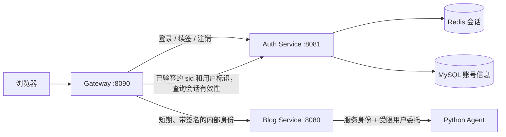

# 独立认证中心与网关统一认证实施计划

状态：2026-10-27 第一版已独立运行并完成本地联调。实现与验证结果见 [运行说明](unified-auth-service.md)。本文件保留最初阶段设计；实际 JWT 使用标准 `typ=JWT` 加 `token_use` 区分用途。数据库仍共享表，现已通过 Auth、Blog、Agent 独立账户与列权限强制限制写入边界，容器配置也接入同一授权脚本。本地正常链路、依赖故障、密钥轮换和双 Blog 实例撤销已实测；完整容器部署尚未执行。OAuth2/OIDC、mTLS 与物理拆库仍是后续里程碑。

目标：以学习服务边界、凭证签发、网关认证、内部身份传递、会话撤销和故障处理为主，完成可运行、可测试、可回滚的独立认证服务。

## 1. 当前实现与必须迁移的依赖

| 当前代码 | 当前职责 | 处理方式 |
|---|---|---|
| `src/main/java/com/easyjob/controller/AuthController.java` | 注册、密码/邮箱登录、验证码、续签、注销 | 迁到认证服务，保留对外 API 形状 |
| `service/AuthSessionService.java` | Redis 会话、设备、密码摘要/账号版本校验 | 迁到认证服务，集中管理会话 |
| `service/AccountSecurityService.java`、`controller/AccountSecurityController.java` | 重置密码、修改密码、设备撤销 | 一并迁移，去掉对 Blog WebSocket 类的直接调用 |
| `utils/JwtUtil.java` | HS512 签发、验签、会话检查混在一起 | 拆分外部 Token 签发和内部身份验证 |
| `gateway/.../EdgeFilter.java` | JWT 基础检查、清理身份头、限流 | 拆成有明确顺序的过滤链 |
| `interceptor/JwtInterceptor.java` | 外部 JWT 与 Redis/DB 会话校验，设置 ThreadLocal | 切换为验证网关内部身份、设置请求上下文 |
| 公开文章/评论/搜索控制器 | 各自解析可选 JWT | 改读统一的可选身份，避免漏迁移 |
| Chat/Article 握手拦截器 | WebSocket 自行解析 JWT，部分路径重复解析 | 接入同一内部身份解析与连接撤销 |
| `service/AdminUserService.java` | 同一事务修改资料、角色和状态 | 角色/状态改由认证服务写，前端明确区分账号安全设置与资料设置 |
| `frontend/src/utils/authSession.ts`、`authRenewal.ts` | 浏览器自动续签与并发保护 | 保持接口兼容，补迁移和过期用例 |
| `agent/security/AgentServiceAuth.java`、Python RPC `principal()` | 共享服务密钥加 userId | 在单独阶段接入用户委托身份，保留独立服务认证 |

已确认的耦合：`user_info` 混合密码、邮箱、status、role、auth_version、昵称、头像和业务统计；`AuthSessionService.valid()` 读 Redis 后还读用户数据库；修改密码/踢设备直接调用 Blog 的连接管理逻辑。不能只搬一个 Controller 就宣布拆分完成。

## 2. 第一版确定的架构

- 新建 `auth-service/`，独立 Spring Boot 进程，Consul 服务名 `easyjob-auth`，本地端口规划 8081；实施前检查冲突。
- 延续 Java 21、当前 Boot 3.4.7/Cloud 2024.0.3 版本线，依赖由相容 BOM 管理。本次不夹带框架大版本升级。
- 通过 Spring Security 的 JWT 编解码组件完成签发/验签，密码继续使用现有 BCrypt 能力。网关使用响应式安全链和 WebClient，不在 Netty 事件线程中执行阻塞 JDBC 或 HTTP。
- 第一版保留站点自有 `/api/auth/*` 登录协议；独立认证服务和 JWKS 不代表已经实现完整 OAuth2/OIDC。标准授权码 + PKCE、OIDC 单点登录列为后续学习里程碑。
- 网关负责外部访问凭证与会话准入；Blog 验证网关身份断言并执行资源权限。认证服务作为会话状态的唯一解释者。
- **状态查询选定内部认证服务接口，不让网关直接读取会话 Redis 格式。** 第一版每个需要身份的业务请求查询一次，无正向缓存，避免缓存导致注销后继续放行。未来只有在明确撤销延迟目标后再引入缓存。
- 第一版允许 Auth 与 Blog 使用同一 MySQL 实例/同一 `user_info` 表的过渡方案；代码和数据库权限限定字段写入归属。物理拆库另设里程碑，不把共享表宣称为数据完全独立。

## 3. 令牌、会话与身份契约

### 3.1 外部 Access Token

- Auth 持有 RSA 私钥，签发 RS256 JWT，`kid` 标识密钥；网关只有公钥。
- 必需声明：`iss`（配置固定）、`aud=easyjob-api`、`sub`（字符串用户 ID）、`sid`、`ver`（账号认证版本）、`iat`、`nbf`、`exp`、`jti`。
- 保留当前 30 分钟访问令牌有效期；时间偏差允许值明确配置为 30 秒。角色不作为可长期信任的外部声明，网关从有效会话查询结果取当前角色。
- JWKS 只输出公钥，通过固定的配置地址加载；不信任 Token 自带的 `jku/x5u` 地址。固定算法允许列表，检查发行者、受众、类型、时间、会话字段及用户 ID 范围。
- 密钥持久化并从忽略目录/容器 secret 挂载；不在每次服务重启时生成新密钥。轮换先公布新公钥再签发，新旧公钥并存至少旧 Token 最长剩余有效期与时钟偏差。

### 3.2 续签凭证与 Redis

- 保留高熵随机续签凭证，浏览器通过 HttpOnly、SameSite=Strict Cookie 携带，Cookie 路径 `/api/auth`，生产启用 Secure。
- Redis 仅存凭证摘要对应的会话，沿用当前闲置 7 天、绝对期限 30 天；会话到期不会靠业务访问无限延长，续签触碰闲置期限。
- 第一版不同时更改续签凭证轮换算法，保留当前稳定凭证及单会话撤销模型，避免拆服务与浏览器并发续签改造相互干扰。
- Auth 校验账号状态、密码变化、`auth_version` 和会话归属；继续保留“退出与续签并发时不能复活会话”的原子校验。
- 改密码/封禁/角色变化递增账号认证版本；单设备退出删除对应会话。失效状态对新准入请求立即生效，不保证撤回已进入业务执行的请求。

### 3.3 网关内部身份

- 使用与 Auth 签发外部 JWT **不同的密钥**，网关私钥签名，Blog/Auth 对应接收方仅持公钥。
- `typ=easyjob-internal+jwt`，`iss=easyjob-gateway`，`aud` 必须是具体目标服务，例如 `easyjob-blog` 或 `easyjob-auth`。
- 内容：`kind=user/anonymous`、`sub`、`sid`、`ver`、当前角色、`iat/exp/jti`、traceId、HTTP method 与规范化目标 path；匿名身份不含用户和会话。
- 默认有效期 15 秒，内部时钟偏差上限 5 秒；接收方拒绝异常超长有效期。用于本次请求准入，不作为 SSE 整段连接的有效期。
- 网关先删除外部传来的所有内部身份/服务认证头，再生成唯一内部头。Blog 不从裸 `X-User-Id` 或请求体获取操作者身份。
- `jti` 用于审计关联，不能将它宣称为自动防重放；15 秒内的凭证重放仍需依靠受保护的传输、方法/路径约束和已有业务幂等。对写请求不做网关自动重试。
- 内部 HTTP/RPC 在本地走回环/受限网络，跨主机部署使用 TLS；mTLS 作为后续服务身份升级。仅限制公网入口不能代替内部凭证验证。

## 4. API 与路由清单

| 路径/接口 | 目标服务 | 认证规则 |
|---|---|---|
| `POST /api/auth/register`、`login`、`login-by-email`、`send-code` | Auth | 不要求已有 Access Token；验证码和频率限制仍适用 |
| `POST /api/auth/refresh`、`logout` | Auth | Cookie 与跨站防护；过期 Access Token 不应挡住续签/退出 |
| `POST /api/auth/password/code`、`password/reset` | Auth | 验证码和防枚举、尝试次数限制 |
| `/api/account/password`、`/api/account/sessions/**` | Auth | 网关完整认证，再由 Auth 验证目标设备归属/当前密码 |
| `PUT /api/admin/accounts/{id}/security`（新增） | Auth | 管理员角色、目标范围、禁止违规自降权/自封禁、乐观版本与审计 |
| `GET /api/auth/jwks`（新增） | Auth | 可公开，只有公钥，独立读限流 |
| `POST /internal/auth/session/check`（新增） | Auth | 仅允许经过服务认证的网关；校验 `sid/sub/ver`，返回 active 和当前身份；此路径不对公网代理 |
| 公开文章、分类、评论列表、搜索 | Blog | 可匿名；如果携带无效凭证则拒绝，不静默降级为匿名 |
| 文章写入、草稿、私信、Agent 会话等 | Blog | 必须认证，再由业务验证资源权限 |
| `/ws/**`、通知 SSE、Agent SSE | Blog | 接入统一身份；连接后还有撤销与资源权限处理 |

路由优先级：Auth 精确路由在泛匹配 Blog `/api/**` 前，WebSocket 路由保持对应升级逻辑。

内部会话查询使用独立高熵服务凭证、限定网关调用方和接口范围，不复用 Agent 共享密钥。请求只传已验签的会话信息，不能按任意 userId 直接返回“已认证”。正常返回不含密码摘要、邮箱验证码或续签原文。内部检查不递归经过公网认证过滤链。

接口分类使用“HTTP 方法 + 路径”的显式规则，覆盖 PUBLIC、OPTIONAL、REQUIRED、INTERNAL；未知 `/api` 路径默认要求身份，最终未匹配处理器再返回 404。不能继续用文件后缀排除所有认证，也不能把未来所有 `/api/auth/**` 接口一律匿名。

统一响应：无效/缺失身份 401、身份有效但无权限 403、认证依赖不可用 503、频率超限 429。网关过滤器只捕获自身认证/限流错误，不把下游业务异常统一改写成“认证服务不可用”。

## 5. 数据写入边界与撤销通知

### 第一版：共享表，单字段所有者

- Auth 独占写入：邮箱凭证、密码、账号 status、全局 role、auth_version、登录时间/IP；Blog 只读用于必要展示。
- Blog 独占写入：昵称、头像、简介、文章/关注计数、硬币、阅读成长等。所有资料更新必须使用明确字段 SQL，移除可能带回旧密码/角色/状态的整实体更新。
- 注册仍需原子创建可用账号与默认资料。过渡期由 Auth 在共享数据库事务内插入 `user_info` 的最小默认资料；把这一点列为已知共享表依赖，保留原有昵称唯一性约束。
- 管理员修改账号安全字段独立走 Auth 命令；昵称/简介走 Blog。前端拆成明确的两个保存动作，避免两个服务部分成功却提示全部成功。Auth 必须再次确认操作者权限和目标账号版本，防止越权或并发覆盖。
- 不立即删旧字段或复制用户 ID；保持现有用户、文章、会话关联。

### 事件与持久化

新增迁移编号实施时取下一个空闲编号，不预占已有编号。建议新增：

| 表 | 核心字段/约束 | 用途 |
|---|---|---|
| `auth_outbox` | event_id 主键、event_type、user_id、sid 可空、auth_version 可空、payload、created_at、next_attempt_at、attempts、published_at、lease_token/lease_until | 账号安全变更提交后可靠发送撤销事件 |
| `auth_audit` | id、command_id 唯一、actor_id、target_id、action、结果、trace_id、时间 | 改密码、封禁、角色调整等审计与命令去重；不存密码/验证码/Token |

- 数据库账号变更与 outbox 在一个事务提交；发布后标记完成，允许重复投递，消费操作必须幂等。
- 使用现有 RabbitMQ 发送用户/会话撤销通知。**每个持有连接的 Blog 实例都要收到**，不能让所有实例竞争同一条消息、导致只有一个节点断线。
- Redis 删除会话与 SQL outbox 不存在跨库原子事务：单设备注销必须以 Redis 删除成功为准，再尽力广播；通知丢失通过连接周期检查补偿，不能宣称跨库恰好一次。
- WebSocket、通知 SSE、Agent SSE 均登记 sid/userId；30 秒内周期性复查状态，事件通知用于尽快断开，周期复查用于补偿。认证服务不可用时，活跃连接在最多一个复查周期加超时时间内关闭。
- 关闭 SSE 订阅不自动删除或取消后台 Agent 任务。新提交的任务、继续任务、草稿写入等受保护动作再次确认当前授权；后台自主只读工作与用户显式写入分别规定撤销行为。

## 6. 按顺序实施的里程碑

### P0：固定现状与接口契约

交付：接口分类清单、用户字段写入清单、身份 DTO/错误码、当前登录/续签/注销/设备/封禁回归基线、服务版本与启动基线。

特别检查：直接解析 JWT 的控制器、WebSocket、通知流、异步线程的 UserContext、上传/下载、服务内部接口。访问令牌、内部令牌和服务凭证都不得出现在日志、URL 记录和测试报告中。

验收：已有功能基线可重复运行，明确每个入口由哪层认证。此阶段不更换生产认证路径。

### P1：抽取认证服务与唯一写入入口

交付：`auth-service/` 独立构建/健康检查、迁移认证/账号安全逻辑、独立配置、SMTP、Redis、账号仓储、管理安全命令与审计；移除对 Blog WebSocket 类的编译依赖。

过渡：先让旧 Java 认证入口作为内部转发适配层，对外 API 保持兼容；必须原样正确转发 Set-Cookie、状态码和 no-store。实际账号与会话修改只由 Auth 执行。旧 HS512 签发仅用于短暂过渡，不同时运行两套账号写入实现。

验收：注册、两种登录、刷新、退出、改/重置密码、设备管理经适配层可用；Auth 停止时身份操作明确失败，不回落到旧本地逻辑；Blog 不再写账号安全字段。

### P2：启用 RS256/JWKS 和新令牌

交付：持久化签名密钥、JWKS、声明校验、受控轮换、新 Token 测试。先使接收方具备新旧明确分流能力，再让 Auth 开始签发新 Token。

迁移决策：学习项目采用一次受控重新登录，切换时统一撤销旧会话/提高认证版本，重新建立 RS256 会话。前端清理旧凭证并显示需重新登录。不开启长期“任意算法都接受”的混合校验。

验收：新令牌经过网关可用；旧令牌在切换后不能恢复已撤销会话；错误签名、alg=none、错 issuer/audience/kid、过期和类型混淆均拒绝；服务重启与正常密钥轮换不会随机掉登录。

### P3：网关承担完整外部认证

交付：独立的身份头清理、路由分类、外部 JWT 验证、会话查询、限流和内部签名过滤器；Auth 路由切到新服务。

顺序：清理外部身份头 → 路由分类/必要预限流 → JWT 检查 → Auth 会话查询 → 用户级限流 → 签发目标服务内部身份 → 转发。公开匿名接口无需会话查询，但向 Blog 发送可信匿名断言。

会话查询总超时 2 秒，第一版不自动重试；无有效结果返回 503。可用的 JWT 公钥使用有界缓存；未知 kid 的刷新有频率限制和并发合并，不能让任意 kid 请求无限触发远程调用。

验收：网关能拦截被注销/封禁的 Token；健康匿名接口不依赖 Auth 会话查询；认证状态不可用时受保护请求不能进入 Blog。统计每次请求状态查询次数，不能隐藏地重复多次查 Redis/数据库。

### P4：Blog 统一消费内部身份

交付：内部 JWT 校验组件、`AuthenticatedPrincipal`（userId/sid/version/roles/traceId）与可选身份；统一 Spring 请求安全上下文，兼容现有 UserContext，完成所有直接 JwtUtil 调用点迁移。

- 校验固定 issuer、目标 audience、算法、公钥、有效期、kind、方法/路径；拒绝外部 Access Token 冒充内部身份。
- 网关以外直连不能凭裸头或用户 Token 访问受保护业务；内部 RPC 仍使用独立服务认证。
- 资源归属、管理员操作、草稿审批仍在业务服务执行；安全关键角色判定不依赖可能陈旧的资料缓存。
- 异步任务显式携带不可变身份，不能假设 ThreadLocal 会跨线程；请求结束必清理。
- WebSocket/SSE 握手加入同一解析链，并执行第 5 节的撤销通知和周期复查。

验收：公开阅读、个性化可选登录、草稿编辑、私信、通知、WebSocket、Agent SSE 均正常；伪造身份头、错目标服务凭证、绕过网关和跨用户资源访问均失败。完成后关闭 Blog 外部 JWT 认证回退。

### P5：Java 与 Agent 的用户委托

交付：在现有 RPC Identity 中增加结构化委托凭证，使用独立发行者与受众；Java→Agent 与 Agent→Blog 分别限接收方和用途，不能直接转发面向 Blog 的网关断言。

- 服务凭证证明哪个服务调用；用户委托证明代表谁、关联哪个会话/运行、允许哪些操作。两者都验证，并校验 userId 一致。
- 委托从已认证的后端上下文生成，不能由模型/tool 参数指定用户。正常身份传递不会自动授予所有 tool capability。
- 单次 RPC 委托短期有效；长任务将服务端授权记录关联 runId/userId/sid，并通过可信后端校验后获得新的短期凭证。不能把过期的网关断言存入 Checkpoint 无限续用。
- 会话取消/账号禁用后，阻止新的交互继续和新的用户授权写入；任务结果、只读后台工作的保留行为明确记录。保存草稿仍需原有 execution token / save permit / 归属校验。

验收：伪造 service key、缺失/篡改委托、用户不一致、过期委托、跨 run、撤销后新写入全部拒绝；正常检索、断点继续、审批保存保持可用。

### P6：部署、真实验证和收尾

交付：更新 `scripts/prepare-local.py`、启动/后台启动脚本，新增 Auth 重启脚本；更新 `deploy/compose.yml`、Docker 构建、网关容器路由、密钥只读挂载、健康检查及最小权限账号。

- 检查顺序：数据库迁移与密钥 → Auth ready → Blog/Agent ready → Gateway ready → 前端入口。
- 公网仅开放统一入口；Auth/Blog/Agent 端口不直出公网。服务发现和 JWKS 地址只从可信配置加载。
- 测试构建完成后，在无活跃 Agent 请求时按既有 admission guard 执行切换。认证服务重启不能重建密钥；网关错误需区分 401 与 503，避免把临时故障当成用户注销。
- 删除迁移适配层、关闭旧共享 JWT 签发密钥、清理旧测试数据和失效兼容代码；文档标注最终身份路径与已知共享表约束。

验收：冷启动、重启、认证服务不可用、Redis 不可用、JWKS 轮换、多实例撤销与正常业务链路均有真实结果。记录至少 100 次暖请求的 p50/p95、会话查询次数和失败率，与 P0 基线比较；报告实际认证 RPC 开销，不预先承诺“更快”。

## 7. 必须通过的验收清单

1. 密码登录、验证码登录、注册和自动登录；错误凭证无用户枚举信息泄漏。
2. 续签并发只更新当前账号；注销与刷新竞态不能重新创建已注销会话。
3. 单设备退出、退出其他设备、修改密码、封禁、角色变化，对后续请求生效；旧浏览器凭证不能续回旧权限。
4. 签名/算法/issuer/audience/type/有效期/kid/目标路径错误；重复内部头和浏览器伪造 userId。
5. 公开、可选登录、必须登录、内部接口四类路径，包含方法区分和未知路径。
6. 外部请求不能直接使用内部状态查询；网关会话查询不能递归进入自身。
7. WebSocket/通知 SSE/Agent SSE 撤销、重连、消息归属；断流不误取消后台任务。
8. Java→Agent→Java 服务身份和用户委托校验；任务 capability 与审批权限没有被登录身份覆盖。
9. Auth/Redis/网络/JWKS 故障时按策略拒绝，无“校验失败就放行”；匿名阅读保持其约定行为。
10. 当前正常功能回归：文章/草稿、评论、好友私信、上传、管理员操作、余额邮件监控。

## 8. 回滚边界

- P0/P1：旧 API 地址作为代理回到已验证 Auth 版本；绝不同时启用两套会话修改者。
- RS256 切换前保留兼容的回滚包和配置。切换后的回滚目标仍需理解新会话和安全字段，不能直接恢复一个忽略新撤销记录的旧程序。
- 回滚认证模式时强制重新登录、撤销两种模式的旧会话；不能恢复旧 Redis 快照或降低 auth_version，否则可能复活被踢掉的登录。
- 第一版仅新增表/配置，保留现有用户 ID 和业务数据。回滚程序不回滚密码、封禁、角色等已经生效的账号安全变更。
- 任何阶段未达验收条件，都保持最近一个完整可用阶段；不能用关闭校验来“恢复访问”。

## 9. 后续学习里程碑（不计入第一版完成）

- 数据独立：新增 Auth 独占账号表/数据库，Blog 保留资料表；注册改成可恢复的账号与资料创建流程，唯一性、幂等、事件重试和失败补偿单独设计，再移除共享表权限。
- 标准身份协议：引入与技术栈版本兼容的 Spring Authorization Server，授权码 + PKCE、OAuth2 客户端登记、OIDC 登录、标准发现端点与 Token Exchange；不能把第一版自定义登录接口标成已经支持这些协议。
- 服务身份升级：mTLS、服务专用工作负载身份、密钥轮换自动化。
- 会话性能优化：在撤销时效约束下评估版本缓存/撤销事件，比较每请求内省与本地验证的延迟和可用性。

## 10. 参考依据

- [Spring Security 响应式 JWT Resource Server](https://docs.spring.io/spring-security/reference/reactive/oauth2/resource-server/jwt.html)：网关使用 JWT 解码、公钥获取与校验能力；具体 API 以项目锁定版本验证。
- [RFC 8725 JWT Best Current Practices](https://www.rfc-editor.org/rfc/rfc8725.html)：算法允许列表、发行者/受众校验和不同 JWT 用途之间的隔离。
- [OWASP Microservices Security](https://cheatsheetseries.owasp.org/cheatsheets/Microservices_Security_Cheat_Sheet.html)：身份传播可验证、调用服务单独认证、业务服务保留资源级授权。
