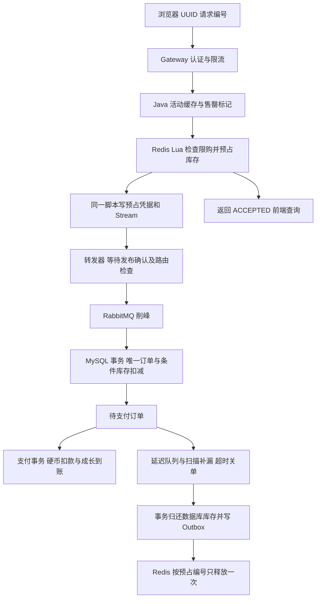

# 硬币兑换阅读成长：秒杀模块

业务规则：每份 10 硬币兑换 1800 秒永久阅读成长。管理员创建限量活动并上线，用户每场只能生成一张订单，关闭后不能重新抢本场。默认支付期限 120 秒，可配置 10～600 秒。额度不倒计时消耗，购买成长不记入真实阅读日报。

## 运行入口

头像账户菜单 →「硬币商城」，或访问 `/growth-shop`。商城展示硬币余额与阅读成长，分为「成长套餐」和「我的订单」，支持兑换、等待异步订单、刷新恢复待确认请求、支付倒计时和硬币支付。个人空间的硬币卡片保留余额统计，移除旧文字入口。

管理员从「管理后台 → 硬币商城」进入活动管理（`/admin?section=growth`），设置名称、名额、起止时间与支付期限，可保存草稿或直接发布，发布失败时保留已创建的草稿供重试；活动列表支持发布、下架、查看库存对账和对账后重新上架。该栏目仅向角色为管理员的操作员展示，所有写操作沿用服务端管理员校验。没有自动生成或开放示例活动，管理员需要自行配置。

2026-10-28 商城界面调整：前端构建通过，6 项使用模拟 API 的 Chromium 界面验收通过，覆盖桌面与手机入口、创建发布、下架与恢复、对账展示、表单校验、发布失败保留草稿、权限隐藏、局部加载失败和刷新后支付。这些界面检查独立于下文历史真实服务验收，本次未额外发布真实活动。

## 链路与代码



- `src/main/java/com/easyjob/growth/`：入口、事务、预占、消息拓扑、消费者、转发与补偿。
- `src/main/resources/growth/reserve.lua`：活动时间、用户限购、库存、凭据、Stream 同步处理。所有 Key 使用活动 `{UUID}` 哈希标签，便于后续学习 Redis Cluster。
- `release.lua`：按预占编号用 Set 去重后加库存；保留用户活动资格占位，落实一人一单规则。
- `frontend/src/views/GrowthShop.vue`：使用原请求编号重试，受理后查询，不把 HTTP 成功当作购买成功。

活动资料缓存 1 秒，售罄标记使用 Caffeine 的 expireAfterWrite，最多保留 1 秒、容量上限 10000。频繁读取不会延长过期时间；库存回补成功只主动清除当前实例对应活动的标记，其余实例由 TTL 失效。售罄标记避免执行完整预占脚本，已有用户占位仍通过 Redis 查询以保持重试语义。没有新增广播，也没有把缓存失效宣称为单请求探测。每用户每场预占入口另有短窗口限制，网关保留现有统一限流。没有宣称已经挡住固定比例流量。

## 数据与一致性

迁移 `031_growth_seckill.sql` 新增活动、订单、硬币流水、成长流水、SQL Outbox 五张表，并增加 `user_reading_progress.purchased_millis`。

`total_millis` 保留真实阅读，等级按 `total_millis + purchased_millis` 计算。购买支付和阅读心跳锁住同一条成长记录，因此不会相互覆盖；阅读日报只记真实心跳。等级展示、后台统计与管理员校正也纳入购买成长。

订单状态为 `PENDING → PAID / CLOSED`，预占无法确认时记为 `REJECTED`。`ACCEPTED` 是 Redis 受理状态，不是已支付订单。库存口径为：数据库可售库存 = 总库存 − 待支付订单数 − 已支付订单数。Redis 可售库存还要减去尚未落单的预占。

支付事务先锁订单，再按 `balance >= cost` 条件扣硬币、写扣款流水、锁成长记录、写成长流水、标记已支付。关闭也锁同一订单，再归还数据库库存并写释放事件。流水的订单/业务类型唯一约束与订单唯一约束共同兜底。扣款后任一步骤失败，整个事务回滚。价格和成长时长从活动配置复制到订单快照，浏览器不能指定用户、价格或到账时长。

数据库对同一用户每场的唯一约束冲突时，额外 Redis 预占会生成释放事件；查询额外凭据会定位到原订单，避免永久排队和库存泄漏。

## 消息、补偿与恢复

Redis Stream 充当预占端的待发送记录。转发器使用 XRANGE 读取有限批次，收到 RabbitMQ 发布确认且没有退回消息后才删除 Stream 记录；多个转发器或确认丢失可产生重复消息。消费者在数据库事务成功后手动 ACK，因此按订单、用户唯一键保证重复消费无重复效果。

RabbitMQ 使用专用 `growth.orders` 交换机与持久队列。落单失败通过 3 秒重试队列返回，达到重试上限转入 `growth.orders.dead` 并记录错误。死信不会自动归还库存，以防误回滚已经完成的订单。管理员可根据预占编号调用人工重试接口；保留死信用于排查，不通过盲目清队列修复。

待支付订单同时写 `EXPIRE` Outbox，通过消息过期及死信路由进入超时检查队列；每秒的数据库扫描补漏。经典队列的逐消息 TTL 可能受队头消息影响，最终是否超时由 MySQL 时间决定，不能依赖消息准时到达。关单后的 `RELEASE` 事件不断重试；Redis 的释放 Set 防止重试多加库存。

管理员可使用：

- `GET /api/growth/admin/activities/{id}/audit`：数据库库存口径、Redis 库存、未确认预占、缺失凭据与待补偿数量。
- `POST .../{id}/pause`：先关闭 Redis 准入标记，再暂停活动；既有未确认请求继续处理为明确结果。
- `POST .../{id}/resume`：必须没有未确认预占/待补偿，凭据完整，且两端库存相同。不会覆盖库存来“修复”差异。
- `POST .../{activityId}/reservations/{reservationId}/retry`：凭原始预占凭据幂等补单；暂停期间会形成拒绝结果并补偿。

Redis、MQ 或数据库异常时，后台转发/补偿会重试，活动状态缺失时拒绝继续准入。Redis 持久化丢失时，尚未落入数据库的 ACCEPTED 请求可能丢失；当前版本不会自动从数据库重建后恢复售卖，需要保留现场、人工核对或结束旧活动后重新建场。单机 Redis/RabbitMQ 不提供多副本故障保证。本模块完成的是可验证的学习链路，尚未做生产容量和故障切换认证。

## 迁移、构建和验证

```powershell
.\python-agent\.venv\Scripts\python.exe scripts\migrate-growth-seckill.py
.\python-agent\.venv\Scripts\python.exe scripts\provision-auth-database.py
```

迁移可重入，原账号余额不变。完整迁移入口 `python -m app.migrate` 同样包含 031。随后构建 Java 与前端，确认 Agent 空闲后顺序重启 Blog。数据库日期沿用项目 JDBC 的 GMT+8 配置，API 输出 ISO UTC 时间，浏览器按本地时区显示。

验证入口：`GrowthPaymentTests`、既有阅读/后台回归、`frontend/tests-e2e/growth-shop.spec.ts`、`scripts/growth-seckill-smoke.py`。真实检查创建独立临时账号，不发验证码邮件、不调用模型；只改变这些账号的余额，完成后删除其订单、流水和活动。结果保存在忽略目录 `temp/growth-smoke-report.json`。

2026-10-28 最终结果：30 项 Java 回归、1 项手机浏览器端到端检查、27 项真实服务检查通过。80 个并发请求争抢 3 份库存只生成 3 张订单；20 个重复支付只扣款一次。余额不足、不同订单同时扣款、中途流水冲突回滚、超时关闭、重复消息、重复补偿、暂停/对账/恢复、Redis 限购记录丢失与活动状态丢失均已检查。测试活动清理后为零，扣币流水没有缺失对应订单。前端、Gateway、Auth、Blog、Agent 最终健康检查均为 200。这些是局部并发和故障检查，不能代替大规模容量测试或多副本故障切换验证。

本地 Blog 的无定时触发器宿主为 `EasyJob-Growth-Java-20261028`，日志 `logs/growth-java-restart.log`。服务运行期间需保留这个宿主；重启使用顺序停止、确认退出、再启动的方式。

第四轮已另行完成多实例压力、消费者崩溃、Redis/RabbitMQ 实际重启、断网及支付关单竞争验收，并修复暂停补偿、支付锁等待跨期、重复消费者快照误判三处问题。完整结果、环境边界和重跑方式见 [第四轮验收](growth-seckill-acceptance.md)。
