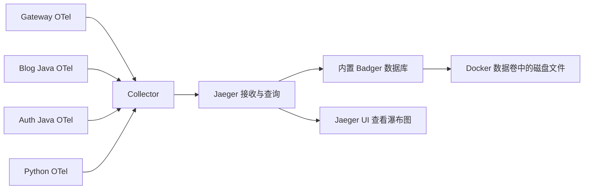

# EasyJob 分布式链路追踪手敲教程

编写日期：2026-10-30，持久化配置更新：2026-10-31，RPC metadata 方案更新：2026-11-01。适用项目：`D:\workspace\easyjob`，Java 21、Spring Boot 3.4.7、Spring Cloud Gateway、Python FastAPI、Dubbo Triple / gRPC、Redis Stream、RabbitMQ、MySQL。

这份教程的目标是让你亲手接通项目里的追踪链路。每一步都给出文件位置、代码、原因和验收方法。旁边的 `examples` 目录保存相同的完整文件，便于对照；应用代码仍需按正文步骤手动修改。业务 Java / Python 代码仍按步骤手敲；第 5.4 节所列的启动和重启脚本已经接入 JVM 探针参数。

Java 示例统一写明类型，包括局部变量、泛型集合、循环变量和 try-with-resources 中的资源声明。

建议按顺序完成，每轮验收通过后再继续。第一轮只做 HTTP，第二轮做跨语言 RPC，第三轮做异步订单，第四轮补齐 Agent、后台任务和前端排障入口。

## 阅读路线

1. [先理解要记录什么](#一先理解要记录什么)
2. [盘点现有代码](#二盘点现有代码)
3. [固定版本与准备目录](#三固定版本与准备目录)
4. [启动 Collector 和 Jaeger](#四启动-collector-和-jaeger)
5. [给三个 Java 服务接入追踪](#五给三个-java-服务接入追踪)
6. [统一 Java 日志和响应编号](#六统一-java-日志和响应编号)
7. [给 Python 接入追踪](#七给-python-接入追踪)
8. [接通 Java 和 Python RPC](#八接通-java-和-python-rpc)
9. [接通 Redis Stream 和 RabbitMQ](#九接通-redis-stream-和-rabbitmq)
10. [记录 Agent 的业务阶段](#十记录-agent-的业务阶段)
11. [处理线程池和后台任务](#十一处理线程池和后台任务)
12. [前端拿到错误的追踪编号](#十二前端拿到错误的追踪编号)
13. [启动、验收与排障](#十三启动验收与排障)
14. [采样、P95 与后续练习](#十四采样p95-与后续练习)
15. [验证范围和资料](#十五验证范围和资料)

## 一、先理解要记录什么

### 1.1 三个核心字段

| 字段 | 表示什么 | 同一条调用链是否相同 |
| --- | --- | --- |
| `trace_id` | 整条调用链的编号 | 相同 |
| `span_id` | 当前这一次操作的编号 | 每个操作不同 |
| `parent_span_id` | 谁触发了当前操作 | 指向直接上游的 Span |

例如浏览器请求购买套餐：

```text
Trace T1
  Gateway SERVER span A
    HTTP CLIENT span B
      Blog SERVER span C
        growth.reserve span D
          Redis CLIENT span E
        HTTP 返回 ACCEPTED

        Redis Stream 中持久化 D 的追踪上下文
          growth.stream.forward span F
            growth.mq.publish span G
              growth.order.materialize span H
                MySQL CLIENT span I
```

E 是 Redis 网络操作，D 是包含幂等查询、售罄缓存检查和预扣逻辑的业务操作。二者都值得记录，耗时含义不同。

HTTP 返回后，F、G、H 仍可继续属于同一条 Trace。父 Span 已经结束，不妨碍后来创建子 Span。Jaeger 中整条 Trace 的持续时间可能因此超过浏览器请求耗时。

### 1.2 traceparent 到底是什么

标准 HTTP 传播格式：

```text
traceparent: 00-4bf92f3577b34da6a3ce929d0e0e4736-00f067aa0ba902b7-01
             │  └──────── trace_id，32个十六进制字符 ────────┘ │          │
             版本                                     父span_id     采样标志
```

最后两个字段分别是 16 个十六进制字符的上游 Span ID，以及追踪标志。下游接收后，会沿用 Trace ID，并创建自己的 Span ID。

由 OpenTelemetry 的传播器生成和解析这些字段。手动拼接字符串容易把父子关系写错。

### 1.3 区分项目中已经出现的几种 ID

| 标识 | 当前用途 | 接入追踪后的处理 |
| --- | --- | --- |
| `X-Request-Id` | 现有请求和日志关联，通常是 UUID | 保留，辅助查旧日志 |
| `X-Trace-Id` | 本教程新增，便于前端复制编号 | 值等于当前 OTel Trace ID |
| `requestId` | 下单或聊天请求的幂等标识 | 保留原有语义 |
| `orderId` | 同一笔订单的业务身份 | 作为 Span 属性关联多次请求 |
| `run_id` | 同一次 Agent 运行的业务身份 | 作为 Span 属性关联执行、恢复和查询 |
| JWT / 服务凭证 | 验证身份和权限 | 继续使用原认证链路 |

重复查询同一个订单会产生多条 Trace；它们通过 `orderId` 关联。不要用 Trace ID 代替幂等键、订单号或授权凭证。

## 二、盘点现有代码

下面是编写时实际查看过的接入点。后续如果文件行号改变，按类名和方法名定位。

| 文件（相对项目根目录） | 目前已有能力 | 本教程要补的能力 |
| --- | --- | --- |
| `gateway/src/main/java/com/easyjob/gateway/UnifiedIdentityFilter.java` | 生成并传递 `X-Request-Id` | 由 Java Agent 传播标准上下文 |
| `gateway/src/main/java/com/easyjob/gateway/RequestTraceFilter.java` | 打印网关请求日志和总耗时 | 日志关联标准 Trace 和 Span |
| `src/main/java/com/easyjob/observability/RequestTrace.java` | 保存旧关联号到 MDC | 保留，避免与 OTel 的 MDC 键冲突 |
| `src/main/java/com/easyjob/agent/rpc/AgentRpcClient.java` | Java 查询 Python 的后台统计、运维和用户偏好 | 普通 RPC CLIENT Span 和上下文传播 |
| `src/main/java/com/easyjob/agent/rpc/BlogRpcProvider.java` | Python 调用 Java 的业务入口 | RPC SERVER Span 和业务状态 |
| `contracts/easyjob_rpc.proto` | 内部普通 RPC 协议，Identity 中有旧 `trace_id` | 标准追踪上下文走 metadata，不增加业务字段 |
| `python-agent/app/security/gateway.py` | 验证网关身份断言并设置旧 trace | HTTP 标准上下文由插桩读取 |
| `python-agent/app/rpc/server.py` | Python 内部 ServiceQuery，只有 unary | 普通 RPC SERVER Span |
| `src/main/resources/growth/reserve.lua` | 原子预扣并写 Stream | 在同一次 XADD 中写追踪元数据 |
| `src/main/java/com/easyjob/growth/GrowthWorkers.java` | Stream 转发、MQ 消费、关单、补偿 | 每条消息单独提取和激活上下文 |
| `python-agent/app/services/stream_delivery.py` | 后台生产 SSE，浏览器订阅不拥有执行 | 独立记录真实 Agent 执行 |

目前 Java HTTP 过滤器的 `http_dispatch` 耗时只覆盖 Servlet 分派阶段；异步响应时，它不等于整个 SSE 生命周期。后续应优先结合自动 HTTP Span、RPC 流 Span 和 Agent 执行 Span 来分析。

## 三、固定版本与准备目录

### 3.1 本教程固定的版本

| 组件 | 版本 | 说明 |
| --- | --- | --- |
| OpenTelemetry Java Agent | `2.33.1` | 官方发布说明对应 SDK `1.67.0` |
| Java API / BOM | `1.67.0` | Java 进程中由 Agent 初始化 SDK |
| Python API / SDK / OTLP HTTP Exporter | `1.45.0` | 与当前项目安装版本一致 |
| Python FastAPI / HTTPX / Redis 插桩 | `0.66b0` | 与 Python SDK 配套；Python 插桩包使用 beta 版本号 |
| OpenTelemetry Collector Contrib | `0.164.0` | 包含 transform 处理器 |
| Jaeger | `2.22.0` | 内置 Badger 磁盘存储，示例保留期 30 天 |

Java 和 Python 的 SDK 版本号不需要相同，它们通过 W3C 上下文和 OTLP 协议交互。每种语言内部的依赖应当对齐。

### 3.2 创建运行配置目录

在 PowerShell 中执行：

```powershell
Set-Location 'D:\workspace\easyjob'
New-Item -ItemType Directory -Force -Path deploy/observability | Out-Null
New-Item -ItemType Directory -Force -Path tools/observability | Out-Null
```

本教程的 Python 依赖文件要手敲到 `python-agent/requirements-tracing.txt`。Java 公共辅助类放在根项目的 `src/main/java/com/easyjob/observability/`。

三个 Java 应用分别构建，根项目不是包含 gateway 和 auth-service 的聚合 Maven 工程。后面的依赖和启动选项都需要分别处理。

## 四、启动 Collector 和 Jaeger

### 4.1 数据如何流动



本教程默认采用 Badger 磁盘持久化。Badger 随 Jaeger 运行，由 Jaeger 管理写入、索引和查询；Java / Python 仍只负责上报追踪数据。

本机应用向 `127.0.0.1:14318` 发送 OTLP/HTTP。容器内部 Collector 向 `jaeger:4317` 发送 OTLP/gRPC。Jaeger 把 Trace 写进 `/var/lib/jaeger`，这个目录挂载到独立的 Docker 数据卷。

### 4.2 新建 deploy/observability/compose.yaml

```yaml
name: easyjob-tracing-lab

services:
  storage-init:
    image: alpine:3.21
    user: "0:0"
    command:
      - sh
      - -ec
      - mkdir -p /data/keys /data/values; chown 10001:10001 /data /data/keys /data/values
    volumes:
      - jaeger-data:/data
    restart: "no"

  jaeger:
    image: jaegertracing/jaeger:2.22.0
    user: "10001:10001"
    command: ["--config=/etc/jaeger/config.yaml"]
    volumes:
      - ./jaeger.yaml:/etc/jaeger/config.yaml:ro
      - jaeger-data:/var/lib/jaeger
    ports:
      - "127.0.0.1:16686:16686"
    depends_on:
      storage-init:
        condition: service_completed_successfully
    mem_limit: 1g
    stop_grace_period: 30s
    restart: unless-stopped

  collector:
    image: otel/opentelemetry-collector-contrib:0.164.0
    command: ["--config=/etc/otelcol/config.yaml"]
    volumes:
      - ./otel-collector.yaml:/etc/otelcol/config.yaml:ro
    ports:
      - "127.0.0.1:14317:4317"
      - "127.0.0.1:14318:4318"
    depends_on:
      - jaeger
    mem_limit: 256m
    restart: unless-stopped

volumes:
  jaeger-data: {}
```

`storage-init` 是一次性目录初始化任务：创建 keys / values 目录，将目录交给 UID/GID 10001，然后退出。Jaeger 使用同一个 UID/GID 运行，并等待初始化成功后启动。这样第一次创建空数据卷时也有写权限。

`jaeger-data:/var/lib/jaeger` 是数据持久化的关键。配置文件挂载为只读，数据库目录单独使用可写的数据卷。

Jaeger 的运行内存上限设为 1GB，Collector 设为 256MB。Badger 仍需要运行内存和缓存，这些上限不决定数据保存在哪里，也不能代替实际容量评估。磁盘数据量受流量和保留期影响。

### 4.3 新建 deploy/observability/jaeger.yaml

```yaml
extensions:
  jaeger_storage:
    backends:
      persistent:
        badger:
          ephemeral: false
          consistency: true
          directories:
            keys: /var/lib/jaeger/keys
            values: /var/lib/jaeger/values
          ttl:
            spans: 720h
  jaeger_query:
    storage:
      traces: persistent
    http:
      endpoint: 0.0.0.0:16686

receivers:
  otlp:
    protocols:
      grpc:
        endpoint: 0.0.0.0:4317

processors:
  batch: {}

exporters:
  jaeger_storage_exporter:
    trace_storage: persistent

service:
  extensions: [jaeger_storage, jaeger_query]
  pipelines:
    traces:
      receivers: [otlp]
      processors: [batch]
      exporters: [jaeger_storage_exporter]
```

这几项要分别理解：

| 配置 | 作用 |
| --- | --- |
| `badger` | 使用 Jaeger 内置的磁盘数据库 |
| `ephemeral: false` | 使用配置中的固定目录 |
| `consistency: true` | Badger 写入时同步落盘，提高写入的持久性，同时增加磁盘同步开销 |
| `directories.keys` / `directories.values` | 两类数据库文件，都必须放在持久化卷内部 |
| `ttl.spans: 720h` | 每个 Span 默认保留 30 天，到期后不可再查询 |
| `traces: persistent` / `trace_storage: persistent` | 查询端和写入端使用同一个逻辑存储名 |

默认保留期在这里明确设为 30 天，可以根据需求改长。持久化与保留期限是两个概念：前者保证已保存数据跨进程 / 容器重启保留，后者决定多久后清理。已有数据不会因为后来调大 TTL 自动延长原来的到期时间。

Badger 单节点存储适合当前练习，后续若需要多个 Jaeger 实例共同提供读写服务，应切到受支持的共享存储后端。多个写入实例不能同时打开同一份 Badger 数据目录。

配置字段依据 Jaeger 2.22 的[官方 Badger 示例](https://github.com/jaegertracing/jaeger/blob/v2.22.0/cmd/jaeger/config-badger.yaml)和[配置定义](https://github.com/jaegertracing/jaeger/blob/v2.22.0/internal/storage/v1/badger/config.go)核对。

### 4.4 新建 deploy/observability/otel-collector.yaml

```yaml
receivers:
  otlp:
    protocols:
      grpc:
        endpoint: 0.0.0.0:4317
      http:
        endpoint: 0.0.0.0:4318

processors:
  memory_limiter:
    check_interval: 1s
    limit_mib: 128
    spike_limit_mib: 32
  transform/safe:
    error_mode: ignore
    trace_statements:
      - context: resource
        statements:
          - delete_key(attributes, "process.command_args")
          - delete_key(attributes, "process.command_line")
      - context: span
        statements:
          - delete_key(attributes, "db.statement")
          - delete_key(attributes, "db.query.text")
          - delete_key(attributes, "http.request.header.authorization")
          - delete_key(attributes, "http.request.header.cookie")
          - delete_key(attributes, "url.query")
          - replace_pattern(attributes["url.full"], "\\?.*$", "") where attributes["url.full"] != nil
          - replace_pattern(attributes["http.url"], "\\?.*$", "") where attributes["http.url"] != nil
          - replace_pattern(attributes["http.target"], "\\?.*$", "") where attributes["http.target"] != nil
      - context: spanevent
        statements:
          - delete_key(attributes, "exception.message")
          - delete_key(attributes, "exception.stacktrace")
  batch:
    timeout: 1s
    send_batch_size: 512

exporters:
  otlp/jaeger:
    endpoint: jaeger:4317
    tls:
      insecure: true
    sending_queue:
      enabled: true
      queue_size: 1024
    retry_on_failure:
      enabled: true
      initial_interval: 1s
      max_interval: 10s
      max_elapsed_time: 30s

service:
  pipelines:
    traces:
      receivers: [otlp]
      processors: [memory_limiter, transform/safe, batch]
      exporters: [otlp/jaeger]
```

这份配置会删除 SQL 正文、查询字符串和自由文本异常详情等容易夹带业务数据的属性。保留耗时、调用关系、错误类型以及我们显式设置的业务编号。后面的代码只写固定属性，避免把 Prompt、文章正文和凭证塞进 Span。

这里的 `memory_limiter` 限制 Collector 的运行内存；最终 Trace 存储已经是 Badger 磁盘文件。Collector 的发送队列、SDK 批处理队列和 Jaeger 接收批次仍有内存缓冲，进程在数据真正落盘前崩溃，可能丢失这部分尚未保存的数据。因此验收要先确认 Trace 已经能够查询，再验证重启和重建后仍能查询，不能把“业务方法已返回”直接当成“Trace 已落盘”。

### 4.5 启动并检查

```powershell
Set-Location 'D:\workspace\easyjob'
docker compose -f deploy/observability/compose.yaml config --quiet
docker compose -f deploy/observability/compose.yaml up -d
docker compose -f deploy/observability/compose.yaml ps -a
docker compose -f deploy/observability/compose.yaml logs --tail 40 storage-init jaeger collector
```

预期 `storage-init` 以退出码 0 结束，Jaeger 和 Collector 运行中。浏览器打开 `http://127.0.0.1:16686`。第一次没有 Trace 是正常的，接入应用或运行下面的合成数据检查后才会有记录。

| 操作 | 数据卷中的已保存数据 |
| --- | --- |
| `docker compose restart jaeger` | 保留 |
| 重建 Jaeger 容器并继续挂载同一个数据卷 | 保留 |
| `docker compose down` 后使用相同项目名和配置再次 up | 保留 |
| `docker compose down -v` | 会删除 Compose 管理的数据卷 |
| 改成另一个 Compose 项目名再 up | 默认创建另一份数据卷，需要确认挂载的是哪一份 |

默认项目名固定为 `easyjob-tracing-lab`。日常重启和升级继续使用同一项目名。持久化数据卷保存在 Docker 的存储区域，在 Windows Docker Desktop 上通常位于其 Linux 虚拟磁盘中，而不是源码目录的 YAML 文件旁边。

如果之前已经运行过旧版 memory 配置，切换后只能持久化新写入的数据；旧进程内存中的历史 Trace 不会自动迁移到 Badger。

### 4.6 验证重启和容器重建后还能查到原 Trace

新建 `D:\workspace\easyjob\scripts\verify-trace-persistence.ps1`，完整代码如下。脚本只发送两条合成追踪数据；执行期间会重启并重建本教程的 Jaeger 容器。

```powershell
param(
    [string]$ComposeFile = 'deploy/observability/compose.yaml',
    [string]$ProjectName = 'easyjob-tracing-lab',
    [string]$CollectorBaseUrl = 'http://127.0.0.1:14318',
    [string]$JaegerBaseUrl = 'http://127.0.0.1:16686'
)

Set-StrictMode -Version Latest
$ErrorActionPreference = 'Stop'
$traceComposePath = (Resolve-Path -LiteralPath $ComposeFile).Path

function Invoke-TraceCompose {
    param([string[]]$Arguments)
    & docker compose --project-name $ProjectName -f $traceComposePath @Arguments
    if ($LASTEXITCODE -ne 0) { throw 'Tracing Docker Compose command failed.' }
}

function Wait-TraceStored {
    param([string]$TraceId, [string]$OperationName)
    $traceDeadline = [DateTime]::UtcNow.AddSeconds(60)
    while ([DateTime]::UtcNow -lt $traceDeadline) {
        try {
            $traceReply = Invoke-RestMethod -Uri "$JaegerBaseUrl/api/traces/$TraceId" -TimeoutSec 3
            $traceDataProperty = $traceReply.PSObject.Properties['data']
            if ($null -ne $traceDataProperty) {
                foreach ($traceItem in @($traceDataProperty.Value)) {
                    if ($null -eq $traceItem -or $traceItem.traceID -ne $TraceId) { continue }
                    foreach ($traceSpan in @($traceItem.spans)) {
                        if ($traceSpan.operationName -eq $OperationName) { return }
                    }
                }
            }
        } catch {
            # During restart the query endpoint may briefly be unavailable.
        }
        Start-Sleep -Milliseconds 500
    }
    throw "Trace was not queryable within 60 seconds: $TraceId"
}

function Send-TraceProbe {
    param([string]$Phase)
    $probeTraceId = [Guid]::NewGuid().ToString('N')
    $probeSpanId = [Guid]::NewGuid().ToString('N').Substring(0, 16)
    $probeOperation = "persistence.$Phase"
    [long]$probeStart = [DateTimeOffset]::UtcNow.ToUnixTimeMilliseconds() * 1000000
    [long]$probeEnd = $probeStart + 1000000
    $probeBody = @{
        resourceSpans = @(@{
            resource = @{
                attributes = @(@{ key = 'service.name'; value = @{ stringValue = 'easyjob-persistence-check' } })
            }
            scopeSpans = @(@{
                scope = @{ name = 'easyjob.persistence-check'; version = '1.0' }
                spans = @(@{
                    traceId = $probeTraceId
                    spanId = $probeSpanId
                    name = $probeOperation
                    kind = 1
                    startTimeUnixNano = $probeStart.ToString([Globalization.CultureInfo]::InvariantCulture)
                    endTimeUnixNano = $probeEnd.ToString([Globalization.CultureInfo]::InvariantCulture)
                    status = @{ code = 1 }
                })
            })
        })
    } | ConvertTo-Json -Depth 20 -Compress
    $probeReply = Invoke-RestMethod -Method Post -Uri "$CollectorBaseUrl/v1/traces" `
        -ContentType 'application/json' -Body $probeBody -TimeoutSec 10
    if ($null -ne $probeReply) {
        $partialProperty = $probeReply.PSObject.Properties['partialSuccess']
        if ($null -ne $partialProperty -and $null -ne $partialProperty.Value) {
            $rejectedProperty = $partialProperty.Value.PSObject.Properties['rejectedSpans']
            if ($null -ne $rejectedProperty -and [long]$rejectedProperty.Value -gt 0) {
                throw 'Collector rejected the synthetic persistence probe.'
            }
        }
    }
    Wait-TraceStored -TraceId $probeTraceId -OperationName $probeOperation
    return @{ TraceId = $probeTraceId; OperationName = $probeOperation }
}

Invoke-TraceCompose -Arguments @('config', '--quiet')
$firstProbe = Send-TraceProbe -Phase 'before-restart'
Write-Host "PASS stored synthetic trace: $($firstProbe.TraceId)"

Invoke-TraceCompose -Arguments @('restart', 'jaeger')
Wait-TraceStored -TraceId $firstProbe.TraceId -OperationName $firstProbe.OperationName
Write-Host 'PASS original trace survives Jaeger restart'

Invoke-TraceCompose -Arguments @('up', '-d', '--no-deps', '--force-recreate', 'jaeger')
Wait-TraceStored -TraceId $firstProbe.TraceId -OperationName $firstProbe.OperationName
Write-Host 'PASS original trace survives container recreation with the same volume'

$secondProbe = Send-TraceProbe -Phase 'after-recreate'
Write-Host "PASS newly written trace after recreation: $($secondProbe.TraceId)"
Write-Host 'Persistence check finished; only synthetic tracing data was submitted.'
```

先确认本章的容器已经启动，再在项目根目录执行：

```powershell
Set-Location 'D:\workspace\easyjob'
& './scripts/verify-trace-persistence.ps1'
```

如果尚未手敲脚本，也可以先运行本文附带的对照版本：

```powershell
& './docs/learning/traceid/examples/powershell/verify-trace-persistence.ps1' -ComposeFile 'deploy/observability/compose.yaml'
```

需要看到四项通过：首次保存、Jaeger 重启后查询原 Trace、容器重建后查询原 Trace、重建后继续写入新 Trace。

这一步不要求 Java / Python 已经接入，也不调用模型。它专门验证 Collector → Jaeger → Badger → 数据卷。后续仍要验收业务 HTTP、RPC 和 MQ 的传播。

### 4.7 给 Badger 做一份停机备份

数据卷使数据跨容器重建保留；磁盘或 Docker 虚拟磁盘损坏时仍需要独立备份。下面将 Jaeger 停止后，把 keys 和 values 一起归档到项目的 `backups/jaeger/`，最后重新启动。

```powershell
Set-Location 'D:\workspace\easyjob'
$traceComposeFile = 'deploy/observability/compose.yaml'
$traceJaegerId = docker compose -f $traceComposeFile ps -q jaeger
if ([string]::IsNullOrWhiteSpace($traceJaegerId)) { throw 'Jaeger must be running before backup.' }
$traceVolume = docker inspect --format '{{ range .Mounts }}{{ if eq .Destination "/var/lib/jaeger" }}{{ .Name }}{{ end }}{{ end }}' $traceJaegerId
if ([string]::IsNullOrWhiteSpace($traceVolume)) { throw 'Jaeger data volume not found.' }
New-Item -ItemType Directory -Force -Path backups/jaeger | Out-Null
$traceBackupDir = (Resolve-Path -LiteralPath backups/jaeger).Path
$traceBackupName = 'jaeger-{0}.tar.gz' -f [DateTime]::UtcNow.ToString('yyyyMMdd-HHmmss')
docker compose -f $traceComposeFile stop jaeger
if ($LASTEXITCODE -ne 0) { throw 'Cannot stop Jaeger for a consistent backup.' }
try {
    docker run --rm --mount "type=volume,source=$traceVolume,target=/source,readonly" --mount "type=bind,source=$traceBackupDir,target=/backup" alpine:3.21 tar -czf "/backup/$traceBackupName" -C /source .
    if ($LASTEXITCODE -ne 0) { throw 'Badger backup failed.' }
    Write-Host "Backup saved: $traceBackupDir\$traceBackupName"
} finally {
    docker compose -f $traceComposeFile start jaeger
}
```

备份时保持 Jaeger 停止，避免 keys / values 处于不同写入状态。恢复时应先解压到一份新的空数据卷，停止 Jaeger 后切换挂载，再用已知 Trace ID 验证；保留原卷到恢复验收完成。恢复备份不会重置 Span 原有的 TTL。

## 五、给三个 Java 服务接入追踪

### 5.1 下载 Agent

```powershell
Set-Location 'D:\workspace\easyjob'
$otelAgentVersion = '2.33.1'
$otelAgentPath = Join-Path (Get-Location) 'tools/observability/opentelemetry-javaagent.jar'
Invoke-WebRequest -Uri "https://github.com/open-telemetry/opentelemetry-java-instrumentation/releases/download/v$otelAgentVersion/opentelemetry-javaagent.jar" -OutFile $otelAgentPath
Get-Item -LiteralPath $otelAgentPath | Select-Object Name, Length
Get-FileHash -LiteralPath $otelAgentPath -Algorithm SHA256
```

如果要验证下载完整性，将本地摘要与该固定版本官方发布页提供的校验信息比较。不要把下载成功当作校验完成。

### 5.2 三个 pom.xml 加入 BOM

分别修改：

```text
D:\workspace\easyjob\pom.xml
D:\workspace\easyjob\gateway\pom.xml
D:\workspace\easyjob\auth-service\pom.xml
```

在每个 POM 的 `<dependencyManagement><dependencies>` 内加入下面这个依赖。如果该 POM 没有 dependencyManagement，就新建这个区块；已有的 Spring Cloud / Spring AI BOM 继续保留。

```xml
<dependency>
    <groupId>io.opentelemetry</groupId>
    <artifactId>opentelemetry-bom</artifactId>
    <version>1.67.0</version>
    <type>pom</type>
    <scope>import</scope>
</dependency>
```

再在每个 POM 的普通 `<dependencies>` 内加入：

```xml
<dependency>
    <groupId>io.opentelemetry</groupId>
    <artifactId>opentelemetry-api</artifactId>
</dependency>
```

使用 BOM 可以同时对齐 API、Context 等依赖，避免只指定 API 版本，却被 Spring Boot 的依赖管理拉入另一版本的 Context。

Java 应用通过 Agent 获得 SDK，不再另外创建 `SdkTracerProvider` 或叠加另一套 tracing starter。

### 5.3 新建 tools/observability/otel-java.properties

```properties
otel.exporter.otlp.endpoint=http://127.0.0.1:14318
otel.exporter.otlp.protocol=http/protobuf
otel.traces.exporter=otlp
otel.metrics.exporter=none
otel.logs.exporter=none
otel.propagators=tracecontext
otel.traces.sampler=parentbased_always_on
otel.bsp.max.queue.size=2048
otel.bsp.max.export.batch.size=512
otel.bsp.schedule.delay=1000
otel.exporter.otlp.timeout=3000
otel.instrumentation.common.logging.trace-id-key=otel_trace_id
otel.instrumentation.common.logging.span-id-key=otel_span_id
otel.instrumentation.apache-dubbo.enabled=false
otel.instrumentation.grpc.enabled=false
otel.instrumentation.rabbitmq.enabled=false
otel.instrumentation.spring-rabbit.enabled=false
otel.instrumentation.jdbc.statement-sanitizer.enabled=true
```

这里先全量采样，且只向 Collector 导出 Trace。MDC 使用 `otel_trace_id` / `otel_span_id`，避免覆盖现有 `RequestTrace` 使用的 `trace_id`。

本教程会手写 Dubbo/gRPC 和 RabbitMQ 传播，因此在 Java Agent 中关闭这几项自动插桩，避免同一边界产生两套传播逻辑。HTTP、JDBC、Redis 等继续由 Agent 处理。未来若切回某项自动插桩，应删除对应的手写边界，重新验收调用关系。

### 5.4 给三个 JVM 添加启动选项

下面是网关的 VM options，IntelliJ 中放在“VM options”，放在 `-jar` 前面时也同样有效：

```text
-javaagent:D:\workspace\easyjob\tools\observability\opentelemetry-javaagent.jar
-Dotel.javaagent.configuration-file=D:\workspace\easyjob\tools\observability\otel-java.properties
-Dotel.service.name=easyjob-gateway
```

Blog Java 的第三行改成 `-Dotel.service.name=easyjob-blog`，认证服务改成 `-Dotel.service.name=easyjob-auth`。

前三个名字会在 Jaeger 的 Service 列表中分别出现。共享属性文件里不要写一个固定 service.name 给所有进程。

使用 PowerShell / 一键启动时，项目脚本已经接入这三项参数，可以直接使用现有启动入口。

| 入口 | 使用的服务名称 |
| --- | --- |
| `scripts/start-local.ps1` | 分别为 Auth、Blog、Gateway 设置名称 |
| `scripts/restart-auth.ps1` | `easyjob-auth` |
| `scripts/restart-java.ps1` | `easyjob-blog` |
| `scripts/restart-gateway.ps1` | `easyjob-gateway` |

后台启动脚本和统一重启脚本调用这些入口，也会使用相同参数。它们读取项目根目录下的 `tools/observability/opentelemetry-javaagent.jar` 和 `otel-java.properties`。

公共参数由 `D:\workspace\easyjob\scripts\java-tracing.ps1` 生成，实际代码如下：

```powershell
# Shared JVM arguments for Start-Process / Start-Hidden argument lines.
function Get-JavaTracingArguments {
    [CmdletBinding()]
    param(
        [Parameter(Mandatory = $true)]
        [ValidateNotNullOrEmpty()]
        [string]$ProjectRoot,

        [Parameter(Mandatory = $true)]
        [ValidateSet('easyjob-auth', 'easyjob-blog', 'easyjob-gateway')]
        [string]$ServiceName
    )

    $projectDirectory = [IO.Path]::GetFullPath($ProjectRoot)
    $agentPath = Join-Path $projectDirectory 'tools\observability\opentelemetry-javaagent.jar'
    $configPath = Join-Path $projectDirectory 'tools\observability\otel-java.properties'
    foreach ($requiredFile in @($agentPath, $configPath)) {
        if (!(Test-Path -LiteralPath $requiredFile -PathType Leaf) -or
            (Get-Item -LiteralPath $requiredFile).Length -eq 0) {
            throw "Missing or empty Java tracing file: $requiredFile. Complete tracing tutorial steps 5.1 and 5.3 before starting or restarting services."
        }
    }

    # Start-Process joins ArgumentList with spaces. Keep quotes for paths with spaces.
    return @(
        ('"-javaagent:{0}"' -f $agentPath)
        ('"-Dotel.javaagent.configuration-file={0}"' -f $configPath)
        ('-Dotel.service.name={0}' -f $ServiceName)
    )
}
```

该函数返回 JVM 参数。调用方把它们放在 `-jar` 前面，再在应用参数中加入 `--spring.profiles.include=tracing`，以便加载第 6.3 节的日志配置。每个服务原有的 `temp/*-runtime.yml` 参数继续参与启动。

启动和重启会先确认探针 JAR、properties 文件存在且非空；文件缺失时直接报错，重启脚本在这项检查通过后才会处理旧服务。路径参数已经加引号，检出目录含空格也能使用。

在项目根目录检查环境：

```powershell
& './scripts/start-local.ps1' -Check
```

按原有方式启动：

```powershell
& './scripts/start-local.ps1' -OpenBrowser
```

也可以双击根目录的 `启动项目.cmd`。第 4 章启动的 Collector 和 Jaeger 用于接收、保存追踪数据。

改动会在下次启动 JVM 时生效。启动器遇到已经运行的实例仍会复用，应用本轮参数需要正常重启对应服务；本次修改脚本没有自动重启业务服务。

这些脚本的参数和缺失文件行为可以单独检查：

```powershell
& './tests/scripts/java-tracing.tests.ps1'
```

测试使用隔离目录和进程命令替身，验证一键启动与三个重启入口的参数，不启动或停止真实业务服务。

## 六、统一 Java 日志和响应编号

### 6.1 新建 TraceSupport.java

目标路径：`D:\workspace\easyjob\src\main\java\com\easyjob\observability\TraceSupport.java`。

```java
package com.easyjob.observability;

import io.opentelemetry.api.GlobalOpenTelemetry;
import io.opentelemetry.api.trace.Span;
import io.opentelemetry.api.trace.SpanBuilder;
import io.opentelemetry.api.trace.SpanContext;
import io.opentelemetry.api.trace.SpanKind;
import io.opentelemetry.api.trace.StatusCode;
import io.opentelemetry.api.trace.Tracer;
import io.opentelemetry.context.Context;
import io.opentelemetry.context.propagation.TextMapGetter;
import java.util.HashMap;
import java.util.Map;

public final class TraceSupport {
    private TraceSupport() {}

    // Resolve lazily: the Java agent owns SDK initialization.
    public static Tracer tracer() {
        return GlobalOpenTelemetry.getTracer("easyjob.business", "1.0");
    }

    public static String currentTraceId() {
        SpanContext context = Span.current().getSpanContext();
        return context.isValid() ? context.getTraceId() : "unavailable";
    }

    public static Map<String, String> inject() {
        Map<String, String> carrier = new HashMap<>();
        GlobalOpenTelemetry.getPropagators().getTextMapPropagator()
            .inject(Context.current(), carrier, Map::put);
        return carrier;
    }

    private static final TextMapGetter<Map<String, String>> GETTER = new TextMapGetter<>() {
        @Override public Iterable<String> keys(Map<String, String> carrier) {
            return carrier.keySet();
        }
        @Override public String get(Map<String, String> carrier, String key) {
            return carrier == null ? null : carrier.get(key);
        }
    };

    public static Context extract(Map<String, String> carrier) {
        // Explicit root prevents a scheduler's unrelated context becoming the parent.
        return GlobalOpenTelemetry.getPropagators().getTextMapPropagator()
            .extract(Context.root(), carrier == null ? Map.of() : carrier, GETTER);
    }

    public static Span start(String name, SpanKind kind) {
        return tracer().spanBuilder(name).setSpanKind(kind).startSpan();
    }

    public static Span receive(String name, SpanKind kind, Map<String, String> carrier) {
        return tracer().spanBuilder(name).setSpanKind(kind)
            .setParent(extract(carrier)).startSpan();
    }

    public static Span linked(String name, Map<String, String> carrier) {
        SpanBuilder builder = tracer().spanBuilder(name).setNoParent();
        SpanContext prior = Span.fromContext(extract(carrier)).getSpanContext();
        if (prior.isValid()) builder.addLink(prior);
        return builder.startSpan();
    }

    public static void failure(Span span, Throwable error) {
        // Free-form exception messages can include SQL values or provider payloads.
        span.setAttribute("error.type", error.getClass().getSimpleName());
        span.setStatus(StatusCode.ERROR);
    }

    public static void businessStatus(Span span, int status) {
        span.setAttribute("easyjob.result.code", status);
        if (status >= 500) span.setStatus(StatusCode.ERROR);
    }
}
```

每次业务操作使用 `startSpan()` 创建 Span，通过 `makeCurrent()` 激活，再在 finally 中 `end()`。`Scope.close()` 恢复线程原来的上下文，`Span.end()` 记录操作结束，它们的职责不同。

不要把 Scope 从一个线程打开后交给另一个线程关闭。异步回调只传 Context / Span，在回调线程中重新打开自己的 Scope。

### 6.2 给网关返回 X-Trace-Id

新建：`D:\workspace\easyjob\gateway\src\main\java\com\easyjob\gateway\TraceResponseWebFilter.java`。

```java
package com.easyjob.gateway;

import io.opentelemetry.api.trace.Span;
import io.opentelemetry.api.trace.SpanContext;
import org.springframework.core.Ordered;
import org.springframework.stereotype.Component;
import org.springframework.web.server.ServerWebExchange;
import org.springframework.web.server.WebFilter;
import org.springframework.web.server.WebFilterChain;
import reactor.core.publisher.Mono;

@Component
public class TraceResponseWebFilter implements WebFilter, Ordered {
    @Override public int getOrder() { return Ordered.HIGHEST_PRECEDENCE; }

    @Override public Mono<Void> filter(ServerWebExchange exchange, WebFilterChain chain) {
        return Mono.defer(() -> {
            SpanContext context = Span.current().getSpanContext();
            String id = context.isValid() ? context.getTraceId() : null;
            if (id != null) {
                exchange.getResponse().beforeCommit(() -> {
                    exchange.getResponse().getHeaders().set("X-Trace-Id", id);
                    return Mono.empty();
                });
            }
            return chain.filter(exchange);
        });
    }
}
```

这里读取 HTTP 自动插桩已经建立的 Span，不在业务过滤器里重复创建网关根 Span。`Mono.defer` 在订阅时读取上下文；响应提交前写入捕获的 ID。

原有 `UnifiedIdentityFilter` 生成的 `X-Request-Id`、签名身份断言和 Token 校验继续保留。标准 `traceparent` 由 HTTP 客户端插桩传播，追踪权限与业务认证独立。

本教程先允许合法的外部 traceparent 延续，便于以后接浏览器追踪。线上如果要求网关强制创建新根 Trace，需要在 HTTP SERVER 插桩读取头之前实施入口策略，不能仅在较晚的 GlobalFilter 中删除头。

### 6.3 给三个 Java 应用加日志格式

分别新建同名文件：

```text
D:\workspace\easyjob\src\main\resources\application-tracing.yml
D:\workspace\easyjob\gateway\src\main\resources\application-tracing.yml
D:\workspace\easyjob\auth-service\src\main\resources\application-tracing.yml
```

三个文件内容相同：

```yaml
logging:
  pattern:
    console: '%d{yyyy-MM-dd HH:mm:ss.SSS} %-5level [trace=%X{otel_trace_id:-} span=%X{otel_span_id:-} request=%X{trace_id:-} run=%X{run_id:-}] %logger{36} - %msg%n'
```

启动参数中已有 `--spring.profiles.include=tracing`，因此会加载该文件。IDE 启动也要启用 tracing profile。

预期日志结构（编号仅为示意）：

```text
INFO [trace=4bf92f... span=00f067... request=旧UUID run=运行UUID] ... rpc_server ...
```

读取当前标准 Trace 时使用 `Span.current()`；MDC 用于日志展示，不作为跨服务传播的来源。

### 6.4 本轮先验收 Java HTTP

先构建、重启三个 Java 服务，然后访问一个公开接口。预期能在 Jaeger 中看到 Gateway → Blog，以及自动识别到的 Redis / MySQL 调用。

```powershell
curl.exe -sS -D temp/trace-http-headers.txt -o temp/trace-http-body.json 'http://127.0.0.1:8090/api/category/list'
Get-Content temp/trace-http-headers.txt
```

响应头应出现 `X-Trace-Id`，是 32 个十六进制字符。复制到 Jaeger 查询，确认 Gateway 与 Blog 的 Trace ID 一致、Span ID 不同。认证服务的在线会话校验通常需要登录请求才能触发，匿名接口不一定经过认证服务。

## 七、给 Python 接入追踪

本节已于 2026-11-01 写入业务代码并安装依赖。当前仓库不用重复手敲初始化；后续内容保留作实现对照和从干净项目接入时的说明。第八章 RPC 仍需单独接入。

### 7.1 新建并安装独立依赖文件

新建 `D:\workspace\easyjob\python-agent\requirements-tracing.txt`：

```text
opentelemetry-api==1.45.0
opentelemetry-sdk==1.45.0
opentelemetry-exporter-otlp-proto-http==1.45.0
opentelemetry-instrumentation-fastapi==0.66b0
opentelemetry-instrumentation-httpx==0.66b0
opentelemetry-instrumentation-redis==0.66b0
```

执行：

```powershell
Set-Location 'D:\workspace\easyjob'
& './python-agent/.venv/Scripts/python.exe' -m pip install -r python-agent/requirements-tracing.txt
& './python-agent/.venv/Scripts/python.exe' -m pip check
```

当前项目安装的 Langfuse 也依赖 OpenTelemetry。先对齐已使用的 `1.45.0`，不要只升级其中一个包。若 pip check 报已有依赖冲突，应确认具体包后处理，不要直接批量升级整个环境。

### 7.2 新建 app/services/tracing.py

目标路径：`D:\workspace\easyjob\python-agent\app\services\tracing.py`。

```python
"""Project tracing; each exporter is explicitly bound to our own provider."""
import asyncio
import inspect
import os
from contextlib import contextmanager
from functools import wraps
from time import time

from opentelemetry import trace
from opentelemetry.context import Context
from opentelemetry.exporter.otlp.proto.http.trace_exporter import OTLPSpanExporter
from opentelemetry.instrumentation.fastapi import FastAPIInstrumentor
from opentelemetry.instrumentation.httpx import HTTPXClientInstrumentor
from opentelemetry.instrumentation.redis import RedisInstrumentor
from opentelemetry.sdk.resources import Resource
from opentelemetry.sdk.trace import TracerProvider
from opentelemetry.sdk.trace.export import BatchSpanProcessor
from opentelemetry.sdk.trace.sampling import ParentBased, TraceIdRatioBased
from opentelemetry.trace import Link, SpanKind, Status, StatusCode
from opentelemetry.trace.propagation.tracecontext import TraceContextTextMapPropagator

_provider = None
_noop = trace.NoOpTracerProvider()
_propagator = TraceContextTextMapPropagator()


def init_tracing(app):
    global _provider
    if _provider is not None or os.getenv("EASYJOB_TRACING_ENABLED", "false").lower() != "true":
        return
    ratio = float(os.getenv("OTEL_TRACES_SAMPLER_ARG", "1.0"))
    if not 0 <= ratio <= 1:
        raise ValueError("OTEL_TRACES_SAMPLER_ARG must be between zero and one")
    endpoint = os.getenv("OTEL_EXPORTER_OTLP_ENDPOINT", "http://127.0.0.1:14318").rstrip("/")
    _provider = TracerProvider(
        resource=Resource.create({"service.name": os.getenv("OTEL_SERVICE_NAME", "easyjob-agent")}),
        sampler=ParentBased(TraceIdRatioBased(ratio)),
    )
    _provider.add_span_processor(BatchSpanProcessor(
        OTLPSpanExporter(endpoint=f"{endpoint}/v1/traces", timeout=3),
        max_queue_size=2048, max_export_batch_size=512, schedule_delay_millis=1000,
    ))
    # Do not replace Langfuse's global TracerProvider.
    FastAPIInstrumentor.instrument_app(
        app, tracer_provider=_provider, excluded_urls=r".*/health(?:/[^?]*)?(?:\?.*)?$",
    )
    HTTPXClientInstrumentor().instrument(tracer_provider=_provider)
    RedisInstrumentor().instrument(tracer_provider=_provider)


async def shutdown_tracing():
    if _provider is not None:
        await asyncio.to_thread(_provider.shutdown)


def tracer():
    return (_provider or _noop).get_tracer("easyjob.business", "1.0")


def capture():
    carrier = {}
    _propagator.inject(carrier)
    return carrier


def remote_context(carrier):
    safe = {key: carrier[key] for key in ("traceparent", "tracestate")
            if isinstance((carrier or {}).get(key), str)}
    return _propagator.extract(safe, context=Context())


def mark_error(span, error):
    span.set_attribute("error.type", type(error).__name__)
    span.set_status(Status(StatusCode.ERROR))


def mark_status(span, status):
    span.set_attribute("easyjob.result.code", int(status))
    if status >= 500:
        span.set_status(Status(StatusCode.ERROR))


@contextmanager
def traced(name, *, kind=SpanKind.INTERNAL, carrier=None, linked=False, attributes=None):
    options = {"kind": kind, "attributes": attributes or {},
               "record_exception": False, "set_status_on_exception": False}
    if linked:
        prior = trace.get_current_span(remote_context(carrier)).get_span_context()
        options.update(context=Context(), links=[Link(prior)] if prior.is_valid else [])
    elif carrier is not None:
        options["context"] = remote_context(carrier)
    with tracer().start_as_current_span(name, **options) as span:
        try:
            yield span
        except (asyncio.CancelledError, GeneratorExit):
            span.set_attribute("easyjob.cancelled", True)
            raise
        except BaseException as error:
            status = getattr(error, "status_code", None)
            if not isinstance(status, int):
                status = getattr(error, "status", None)
            if isinstance(status, int):
                mark_status(span, status)
            else:
                mark_error(span, error)
            raise


def trace_stage(name):
    def decorate(function):
        if not inspect.iscoroutinefunction(function):
            raise TypeError("trace_stage is for coroutine functions, not async generators")

        @wraps(function)
        async def wrapped(*args, **kwargs):
            with traced(name):
                return await function(*args, **kwargs)
        return wrapped
    return decorate


def attach_job_trace(payload):
    return {**payload, "_trace": capture(), "_trace_enqueued_ms": int(time() * 1000)}


@contextmanager
def durable_job_span(job):
    payload = job["payload"]
    with traced("agent.background_job", carrier=payload.get("_trace", {}), linked=True,
                attributes={"easyjob.job.kind": str(job["kind"]),
                            "easyjob.job.id": str(job["job_id"])}) as span:
        queued = payload.get("_trace_enqueued_ms")
        if isinstance(queued, (int, float)):
            span.set_attribute("easyjob.queue.wait_ms", max(0, int(time() * 1000 - queued)))
        yield span
```

这份代码有意使用项目私有的 TracerProvider，并显式传给插桩库。它不替换 Langfuse 的全局 Provider，避免两个 SDK 争抢初始化。不同 Provider 创建的 Span 仍可以通过当前 Context 形成父子关系，但只会由各自的 exporter 导出。

本教程向 Jaeger 记录运行阶段和耗时。现有 Langfuse 的 observe 装饰器如果激活了一个只导出到 Langfuse 的父 Span，Jaeger 中可能看到缺失的父节点。第一次学习联调建议启用下面的本地开关，先完整跑通系统追踪，再单独练习两个平台共享 Provider 和导出筛选。

在 `app/services/observability.py` 的导入区增加：

```python
import os
```

在 `get_langfuse_callback()` 的 docstring 之后、现有 try 之前加入：

```python
if os.getenv("EASYJOB_TRACING_LAB_ONLY", "false").lower() == "true":
    return None
```

在同文件 `trace_node(node_name)` 的内部 `decorator(func)` 函数开头加入：

```python
if os.getenv("EASYJOB_TRACING_LAB_ONLY", "false").lower() == "true":
    return func
```

这个开关在模块导入、装饰器绑定之前就要设置，因此改变以后需重启 Python。只修改环境变量而不重启，已经绑定的 observe 装饰器仍然存在。联调期间 Langfuse 节点装饰器和 LLM callback 会停用；已有 RunMetrics、费用统计和业务逻辑继续执行。

### 7.3 在 main.py 接入初始化和关闭

在 `python-agent/app/main.py` 导入区加入：

```python
from app.services.tracing import init_tracing, shutdown_tracing
```

找到现有的 app 创建语句，在后面加入初始化：

```python
app = FastAPI(title="EasyJob Python Agent", lifespan=lifespan)
init_tracing(app)
```

当前 lifespan 完整实现如下。数据库连接也处于 try 内，资源清理外层使用 finally 保证 shutdown_tracing 在初始化或清理失败时仍被调用：

```python
@asynccontextmanager
async def lifespan(app: FastAPI):
    rpc_server = None
    log.info("Agent Token budgets: total=%d main_output=%d worker_output=%d safety=%d compact_trigger=%d compact_target=%d recent=%d summary=%d article=%d history_load=%d summary_input=%d",
             settings.MAIN_CONTEXT_MAX_TOKENS, settings.MAIN_OUTPUT_MAX_TOKENS, settings.WORKER_OUTPUT_MAX_TOKENS,
             settings.CONTEXT_SAFETY_TOKENS, settings.CONTEXT_COMPACT_TRIGGER_TOKENS, settings.CONTEXT_COMPACT_TARGET_TOKENS, settings.HISTORY_RECENT_TOKENS,
             settings.SUMMARY_MAX_TOKENS, settings.ARTICLE_CONTEXT_MAX_TOKENS, settings.HISTORY_LOAD_MAX_TOKENS,
             settings.SUMMARY_INPUT_MAX_TOKENS)
    try:
        await mysql_client.startup()
        await check_message_schema(mysql_client.db)
        await check_content_schema(mysql_client.db)
        await check_runtime_schema(mysql_client.db)
        await check_memory_schema(mysql_client.db)
        await check_jobs_schema(mysql_client.db)
        await check_article_conversation_schema(mysql_client.db)
        await check_delivery_schema(mysql_client.db)
        await check_heartbeat_schema(mysql_client.db)
        await check_maintenance_schema(mysql_client.db)
        await check_task_recovery_schema(mysql_client.db)
        from app.migrate import check_service_boundaries
        await check_service_boundaries(mysql_client.db)
        from app.migrate import check_product_features
        await check_product_features(mysql_client.db)
        if len(settings.AGENT_SERVICE_KEY.encode()) < 32:
            raise RuntimeError("请为 Java 和 Python 配置相同的 AGENT_SERVICE_KEY，至少32字节")
        if settings.GATEWAY_IDENTITY_PUBLIC_KEY_FILE:
            from app.security.gateway import public_key
            from app.security.stream_sessions import sessions
            public_key()
            await sessions.start()
        from app.clients.es_client import BaseEsClient
        es = BaseEsClient()
        try:
            await es.ensure_user_memories_index()
        finally:
            await es.client.close()
        # Fail startup if RedisJSON/RediSearch or checkpoint indexes are unavailable.
        # Otherwise /health can succeed while the first chat/approval fails.
        await get_graph()
        server_configs = json.loads(settings.MCP_SERVERS_JSON)
        if server_configs:
            await mcp_manager.connect(server_configs)
            tool_registry.refresh()
        background_worker.start()
        if settings.INTERNAL_TRANSPORT not in ('http', 'triple'):
            raise RuntimeError('AGENT_INTERNAL_TRANSPORT 必须是 http 或 triple')
        if settings.AGENT_RPC_ENABLED:
            from app.rpc.server import start_server
            rpc_server = await start_server()
        from app.rpc.discovery import catalog
        if catalog.enabled and (not settings.AGENT_RPC_ENABLED or settings.INTERNAL_TRANSPORT != 'triple'):
            raise RuntimeError('服务发现模式需要启用 Triple RPC')
        await catalog.start()
        yield
    finally:
        try:
            from app.security.stream_sessions import sessions
            await sessions.close()
            if rpc_server is not None:
                await rpc_server.stop(3)
            await stream_delivery.shutdown()
            await background_worker.shutdown()
            await run_service.shutdown()
            await close_graph()
            await mcp_manager.shutdown()
            await mysql_client.shutdown()
            from app.rpc.blog_client import close_client
            from app.rpc.discovery import catalog
            await catalog.close()
            await close_client()
            from app.services.main_context import context_service
            await context_service._redis.client.aclose()
        finally:
            await shutdown_tracing()
```

关闭只发生在服务退出时，不在每个接口结束时调用；只关闭系统追踪的私有 Provider。

本教程使用显式初始化，不再通过 `opentelemetry-instrument` 命令重复启动同一组插桩。

### 7.4 设置启动环境变量

start-local.ps1、restart-agent.ps1、restart-unified-auth.ps1 已通过 scripts/python-tracing.ps1 为 Python 提供下列进程级默认值，显式设置的非空值不会被覆盖。设置 EASYJOB_TRACING_ENABLED=false 可关闭系统追踪；设置 EASYJOB_TRACING_LAB_ONLY=false 可保留 Langfuse 节点装饰器和 LLM callback。没有修改用户级或系统级环境变量。


在启动 Python 的同一个 PowerShell 进程中设置：

```powershell
$env:EASYJOB_TRACING_ENABLED = 'true'
$env:EASYJOB_TRACING_LAB_ONLY = 'true'
$env:OTEL_SERVICE_NAME = 'easyjob-agent'
$env:OTEL_EXPORTER_OTLP_ENDPOINT = 'http://127.0.0.1:14318'
$env:OTEL_TRACES_SAMPLER_ARG = '1.0'
```

随后沿用原有启动器和 runtime 配置启动 Python。手动运行 uvicorn 的核心命令仍为：

```powershell
Set-Location 'D:\workspace\easyjob\python-agent'
& './.venv/Scripts/python.exe' -m uvicorn app.main:app --host 127.0.0.1 --port 8000
```

这条命令需要你原有的数据库、密钥、checkpoint 和服务发现配置已经加载。当前项目启动器设置的 `EASYJOB_AGENT_RUNTIME` 等变量也要保留。Windows 计划任务或 IDE 启动的进程不会自动继承另一个终端后来设置的变量，需要在实际启动入口中配置。

### 7.5 在 Python 日志中加入当前标准 Trace

修改 `python-agent/app/services/logging_config.py`。导入区加入：

```python
from opentelemetry import trace as otel_trace
```

用下面的方法替换 `TraceFilter.filter`，保留类名和其它函数：

```python
def filter(self, record: logging.LogRecord) -> bool:
    record.trace_id = _trace_id.get()
    record.conv_id = _conversation_id.get()
    record.run_id = _run_id.get()
    context = otel_trace.get_current_span().get_span_context()
    record.otel_trace_id = f"{context.trace_id:032x}" if context.is_valid else "-"
    record.otel_span_id = f"{context.span_id:016x}" if context.is_valid else "-"
    return True
```

将 `setup_logging()` 中的 fmt 赋值改为：

```python
fmt = "%(asctime)s | %(levelname)-5s | [trace=%(otel_trace_id)s span=%(otel_span_id)s request=%(trace_id)s conv=%(conv_id)s run=%(run_id)s] | %(name)s | %(message)s"
```

这样旧 ContextVar 关联号和 OTel 标准编号都会保留，当前激活的 Span 也会出现在日志中。

### 7.6 Python 的 MySQL 调用

项目使用 `databases + aiomysql`。这里提供显式包装，避免直接套用另一个 MySQL 驱动的插桩并误以为已经生效。

新建 `D:\workspace\easyjob\python-agent\app\services\traced_database.py`：

```python
from databases import Database
from contextlib import aclosing
from opentelemetry.trace import SpanKind
from app.services.tracing import traced


class TracedDatabase(Database):
    def _operation(self, name):
        # Deliberately record the operation, not query text, parameters or results.
        return traced(f"mysql.{name}", kind=SpanKind.CLIENT,
                      attributes={"db.system.name": "mysql", "db.operation.name": name})

    async def fetch_all(self, query, values=None):
        with self._operation("fetch_all"):
            return await super().fetch_all(query, values)

    async def fetch_one(self, query, values=None):
        with self._operation("fetch_one"):
            return await super().fetch_one(query, values)

    async def fetch_val(self, query, values=None, column=0):
        with self._operation("fetch_val"):
            return await super().fetch_val(query, values, column)

    async def execute(self, query, values=None):
        with self._operation("execute"):
            return await super().execute(query, values)

    async def execute_many(self, query, values):
        with self._operation("execute_many"):
            return await super().execute_many(query, values)

    async def iterate(self, query, values=None):
        with self._operation("iterate"):
            async with aclosing(super().iterate(query, values)) as rows:
                async for row in rows:
                    yield row
```

修改 `python-agent/app/clients/mysql_client.py`，完整内容为：

```python
from app.config import settings
from app.services.traced_database import TracedDatabase

db = TracedDatabase(settings.mysql_url)


async def startup():
    await db.connect()


async def shutdown():
    await db.disconnect()
```

它记录从调用 Database 方法到返回的总时间，可能包含连接获取等待，不是数据库纯执行时间。原有 `transaction()` 行为继续由父类处理；如果某处直接调用 `db.connection()` 返回对象的方法，会绕过这些重写，需要在那个接入点单独补 Span。

`iterate()` 的 Span 会持续到迭代结束，调用者提前退出时应关闭异步迭代器。第一轮重点验证 fetch / execute 路径。

## 八、接通 Java 和 Python RPC

### 8.1 用 metadata 传播，不修改业务协议

Java 使用 Dubbo Triple，Python 使用 gRPC。双方通过 HTTP/2 metadata 传递标准 W3C 的 traceparent 和可选 tracestate。Java 的字符串 invocation attachments 会被 Triple 写进 HTTP/2 请求头；Python 从 invocation_metadata() 读取，反方向也走同一通道。

本章不向 Identity 添加追踪字段，不修改 contracts/easyjob_rpc.proto，不需要为本章重新生成协议代码。原有 trace_id 仍是已有日志关联号，不能代替包含父 Span ID 和采样标记的 traceparent。service_key、委托令牌、会话版本和业务权限检查保留原样。

| 位置 | 创建 Span | 传播上下文 |
| --- | --- | --- |
| Java 调用 Python | TracingAgentRpc 代理，记录普通调用生命周期 | consumer Filter 注入 metadata |
| Python 接收 Java | RpcServerTracingInterceptor | 从 metadata 提取父上下文 |
| Python 调用 Java | RpcClientTracingInterceptor | 创建 CLIENT Span 后注入 metadata |
| Java 接收 Python | provider Filter | 从 invocation attachments 提取父上下文 |

Java Agent 的 apache-dubbo / grpc 自动插桩保持关闭，Python 不再额外启用 gRPC 自动插桩。每一跳只创建一套 CLIENT / SERVER Span。

### 8.2 Java：新增 Dubbo metadata Filter 并注册 SPI

新建 D:\workspace\easyjob\src\main\java\com\easyjob\observability\RpcMetadataFilter.java：

~~~java
package com.easyjob.observability;

import com.easyjob.rpc.v1.Reply;
import io.opentelemetry.api.trace.Span;
import io.opentelemetry.api.trace.SpanKind;
import io.opentelemetry.context.Scope;
import org.apache.dubbo.common.extension.Activate;
import org.apache.dubbo.rpc.Filter;
import org.apache.dubbo.rpc.AppResponse;
import org.apache.dubbo.rpc.Invocation;
import org.apache.dubbo.rpc.Invoker;
import org.apache.dubbo.rpc.Result;
import org.apache.dubbo.rpc.RpcException;
import org.apache.dubbo.rpc.model.MethodDescriptor;
import org.apache.dubbo.rpc.model.ServiceModel;
import java.util.HashMap;
import java.util.List;
import java.util.Map;

@Activate(group = {"consumer", "provider"})
public final class RpcMetadataFilter implements Filter {
    private static final List<String> KEYS = List.of("traceparent", "tracestate");

    @Override
    public Result invoke(Invoker<?> invoker, Invocation invocation) throws RpcException {
        if (!"tri".equals(invoker.getUrl().getProtocol())) {
            return invoker.invoke(invocation);
        }
        String side = invoker.getUrl().getParameter("side");
        if ("consumer".equals(side)) {
            // Callers use TracingAgentRpc.wrap(...) to activate a CLIENT span.
            Map<String, String> carrier = TraceSupport.inject();
            for (String key : KEYS) {
                invocation.getObjectAttachments().remove(key);
                String value = carrier.get(key);
                if (value != null) invocation.setAttachment(key, value);
            }
            // Triple serializes string attachments into HTTP/2 metadata.
            return invoker.invoke(invocation);
        }
        if (!"provider".equals(side)) {
            return invoker.invoke(invocation);
        }

        // This provider wrapper supports unary results, not stream lifetimes.
        ServiceModel model = invocation.getServiceModel();
        if (model == null) model = invoker.getUrl().getServiceModel();
        if (model != null) {
            MethodDescriptor descriptor = model.getServiceModel()
                .getMethod(invocation.getMethodName(), invocation.getParameterTypes());
            if (descriptor != null && descriptor.getRpcType() != MethodDescriptor.RpcType.UNARY) {
                return invoker.invoke(invocation);
            }
        }

        Map<String, String> carrier = new HashMap<>();
        for (String key : KEYS) {
            String value = invocation.getAttachment(key);
            if (value != null) carrier.put(key, value);
        }
        String rpcService = invoker.getInterface().getName();
        String rpcMethod = invocation.getMethodName();
        Span span = TraceSupport.receive(rpcService + "/" + rpcMethod, SpanKind.SERVER, carrier);
        span.setAttribute("rpc.system", "grpc");
        span.setAttribute("rpc.service", rpcService);
        span.setAttribute("rpc.method", rpcMethod);
        try (Scope scope = span.makeCurrent()) {
            Result result = invoker.invoke(invocation);
            if (result instanceof AppResponse) {
                // Already completed: AppResponse does not support completion callbacks.
                try { recordResult(span, result, null); }
                finally { span.end(); }
                return result;
            }
            // Wait for the actual unary result, including asynchronous results.
            return result.whenCompleteWithContext((completed, failure) -> {
                try { recordResult(span, completed, failure); }
                finally { span.end(); }
            });
        } catch (RuntimeException | Error failure) {
            TraceSupport.failure(span, failure);
            span.end();
            throw failure;
        }
    }

    private static void recordResult(Span span, Result result, Throwable failure) {
        if (failure != null) TraceSupport.failure(span, failure);
        else if (result.hasException()) TraceSupport.failure(span, result.getException());
        else if (result.getValue() instanceof Reply reply) {
            TraceSupport.businessStatus(span, reply.hasError() ? reply.getError().getStatus() : 200);
        }
    }
}
~~~

consumer 分支对所有 Triple 接口注入当前上下文，不再判断 AgentRpc.class；对应 CLIENT Span 由下一节代理创建。provider 分支不再限定 BlogRpc.class，对 unary 方法等待 Result 完成后结束 SERVER Span。通过 Dubbo 方法描述符识别出的流式 provider 会直接放行，避免把流的开始误记为结束；未来 Java 流式 provider 的完整追踪需要单独接入流生命周期。

示例保留 provider 角色判断以明确执行边界。在 @Activate 只用于两端、所有 consumer 已返回的前提下，此角色判断也可以省略；它不再限制业务接口。

Span 名称统一为“RPC 接口全名/方法名”。Java 从 invoker.getInterface().getName() 获取 rpc.service，Python 从 gRPC 完整方法路径提取服务名。rpc.service 是 RPC 契约名；Jaeger 里的部署应用名来自 service.name，即各服务的 otel.service.name / OTEL_SERVICE_NAME 配置。

本节通用于 Triple / gRPC 接口命名，不是跨协议组件；Filter 会跳过非 tri 协议。统一 Reply 的业务错误映射继续保留，其它响应 DTO 需要按自己的业务约定扩展映射，RPC 异常仍会记录。

新建 D:\workspace\easyjob\src\main\resources\META-INF\dubbo\org.apache.dubbo.rpc.Filter，这是没有扩展名的文本文件，完整内容：

~~~properties
easyjob-rpc-tracing=com.easyjob.observability.RpcMetadataFilter
~~~

Dubbo 通过 SPI 和 @Activate 加载，不使用 Spring @Component。只有 Java 类而没有 SPI 资源文件，Filter 不会生效。

使用 invocation 级附件，不把 traceparent 留在 RpcContext 的线程本地客户端附件中，避免线程复用时串线。只处理两个追踪键，不读取或打印业务请求和身份凭证。

### 8.3 Java：普通 RPC 客户端 Span

新建 D:\workspace\easyjob\src\main\java\com\easyjob\observability\TracingAgentRpc.java：

~~~java
package com.easyjob.observability;

import com.easyjob.rpc.v1.AgentRpc;
import com.easyjob.rpc.v1.Reply;
import io.opentelemetry.api.trace.Span;
import io.opentelemetry.api.trace.SpanKind;
import io.opentelemetry.context.Scope;
import java.lang.reflect.InvocationTargetException;
import java.lang.reflect.Proxy;
import java.util.concurrent.CompletionStage;
import java.util.concurrent.atomic.AtomicBoolean;

/** Unary RPC tracing for the internal administrative/profile query client. */
public final class TracingAgentRpc {
    private TracingAgentRpc() {}

    public static AgentRpc wrap(AgentRpc delegate) {
        return wrap(AgentRpc.class, delegate);
    }

    public static <T> T wrap(Class<T> rpcInterface, T delegate) {
        return rpcInterface.cast(Proxy.newProxyInstance(rpcInterface.getClassLoader(),
            new Class<?>[]{rpcInterface}, (proxy, method, originalArgs) -> {
                Object[] args = originalArgs == null ? new Object[0] : originalArgs;
                if (method.getDeclaringClass() == Object.class) {
                    try { return method.invoke(delegate, args); }
                    catch (InvocationTargetException error) { throw error.getCause(); }
                }
                Span span = TraceSupport.tracer().spanBuilder(rpcInterface.getName() + "/" + method.getName())
                    .setSpanKind(SpanKind.CLIENT).startSpan();
                span.setAttribute("rpc.system", "grpc");
                span.setAttribute("rpc.service", rpcInterface.getName());
                span.setAttribute("rpc.method", method.getName());
                AtomicBoolean ended = new AtomicBoolean();
                Runnable end = () -> { if (ended.compareAndSet(false, true)) span.end(); };
                try (Scope scope = span.makeCurrent()) {
                    Object reply;
                    try { reply = method.invoke(delegate, args); }
                    catch (InvocationTargetException error) { throw error.getCause(); }
                    if (reply instanceof CompletionStage<?> stage) {
                        stage.whenComplete((value, failure) -> {
                            try (Scope callbackScope = span.makeCurrent()) {
                                record(span, value, failure);
                            } finally { end.run(); }
                        });
                    } else {
                        record(span, reply, null);
                        end.run();
                    }
                    return reply;
                } catch (Throwable failure) {
                    TraceSupport.failure(span, failure);
                    end.run();
                    throw failure;
                }
            }));
    }

    private static void record(Span span, Object value, Throwable failure) {
        if (failure != null) TraceSupport.failure(span, failure);
        else if (value instanceof Reply reply)
            TraceSupport.businessStatus(span, reply.hasError() ? reply.getError().getStatus() : 200);
    }
}
~~~

代理先创建 CLIENT Span 并激活，调用远端时 consumer Filter 才读取这个上下文并注入 metadata。因此远端 SERVER 的直接父节点是这次 RPC 的 CLIENT Span。

普通调用返回后结束 Span，CompletionStage 等待异步结果完成。AtomicBoolean 防止重复结束，业务消息不复制、不修改。当前内部 RPC 协议不再提供聊天流、运行事件流等方法。

修改 src/main/java/com/easyjob/agent/rpc/AgentRpcClient.java 的构造方法：

~~~java
public AgentRpcClient(AgentRpc remote, AgentServiceAuth auth) {
    this.remote = com.easyjob.observability.TracingAgentRpc.wrap(remote);
    this.auth = auth;
}
~~~

不要在 TripleRuntime 或每个业务方法中重复包装。服务发现返回的远端代理仍经过统一入口，SPI Filter 对新建的 Dubbo reference 也会生效。

TracingAgentRpc 保留旧类名及 wrap(AgentRpc) 入口以兼容本项目；新增的 wrap(Class<T>, T) 重载可用于其它 RPC 接口。新增 reference 也要经过该入口，不能只注册 Filter 就认为自动创建了 CLIENT Span。代理只支持普通返回和 CompletionStage 异步完成。当前 AgentRpc / BlogRpc 均为普通请求响应；如果以后新增流式 RPC，必须单独实现流的追踪生命周期，不能直接复用本节代理。

### 8.4 当前聊天使用 HTTP/SSE，不经过 Java RPC

前端 /api/agent/** 由 Gateway 直接路由到 Python。Python 通过 HTTP/SSE 返回聊天正文、审批继续、运行事件和恢复输出，Java Blog 不参与这些数据流的中转。

Java 原有 AgentController、AgentService、AiConversationService、记忆 / 交付指标转发接口，以及对应的聊天 / 历史 / 记忆 RPC 方法已经清理。后台管理、统计、就绪检查和用户偏好查询仍通过 ServiceQuery 调用 Python。

Python 调 Java 的 BlogRpc 只有文章 / 草稿读取、草稿保存、维护和回执等普通请求响应，也没有流式方法。因此本章只接通双向普通 RPC；聊天流用 Gateway HTTP 插桩、Python FastAPI 插桩和第十章的后台执行 / 模型 Span 观测，无需手写 Java Flux 上下文恢复代码。

### 8.5 Python：新增客户端和服务端 gRPC 拦截器

新建 D:\workspace\easyjob\python-agent\app\services\trace_rpc.py：

~~~python
"""gRPC metadata propagation, independent of business Protobuf fields."""

import grpc
from opentelemetry.trace import SpanKind
from app.services.tracing import capture, traced, mark_status

TRACE_KEYS = frozenset(("traceparent", "tracestate"))


def outgoing_metadata(existing):
    # Preserve caller metadata; replace stale trace keys.
    metadata = [(key, value) for key, value in (existing or ()) if key not in TRACE_KEYS]
    metadata.extend((key, value) for key, value in capture().items() if key in TRACE_KEYS)
    return tuple(metadata)


def incoming_metadata(metadata):
    carrier = {}
    duplicated = set()
    for key, value in metadata or ():
        if key in TRACE_KEYS and isinstance(value, str):
            if key in carrier:
                duplicated.add(key)
            carrier[key] = value
    # Ambiguous context becomes a new root, not a business error.
    return {} if duplicated else carrier


def reply_status(reply):
    descriptor = getattr(reply, "DESCRIPTOR", None)
    if descriptor is None or descriptor.full_name != "com.easyjob.rpc.v1.Reply":
        # Other interfaces can use another DTO; add its business mapping separately.
        return 200
    if reply.HasField("error"):
        return reply.error.status
    return 200 if reply.HasField("data") else 502


def rpc_identity(full_method):
    if isinstance(full_method, bytes):
        full_method = full_method.decode("ascii")
    service, method = full_method.lstrip("/").rsplit("/", 1)
    return service, method


class RpcClientTracingInterceptor(grpc.aio.UnaryUnaryClientInterceptor):
    async def intercept_unary_unary(self, continuation, details, request):
        service, method = rpc_identity(details.method)
        with traced(f"{service}/{method}", kind=SpanKind.CLIENT,
                    attributes={"rpc.system": "grpc", "rpc.service": service, "rpc.method": method}) as span:
            outbound = grpc.aio.ClientCallDetails(
                details.method, details.timeout, outgoing_metadata(details.metadata),
                details.credentials, details.wait_for_ready,
            )
            call = await continuation(outbound, request)
            # Await the response, not just creation of the asynchronous Call.
            reply = await call
            mark_status(span, reply_status(reply))
            return reply


class RpcServerTracingInterceptor(grpc.aio.ServerInterceptor):
    async def intercept_service(self, continuation, details):
        handler = await continuation(details)
        if handler is None or handler.request_streaming or handler.response_streaming:
            return handler
        service, method = rpc_identity(details.method)
        attributes = {"rpc.system": "grpc", "rpc.service": service, "rpc.method": method}

        async def unary(request, context):
            with traced(f"{service}/{method}", kind=SpanKind.SERVER,
                        carrier=incoming_metadata(context.invocation_metadata()),
                        attributes=attributes) as span:
                reply = await handler.unary_unary(request, context)
                mark_status(span, reply_status(reply))
                return reply

        return grpc.unary_unary_rpc_method_handler(unary,
            request_deserializer=handler.request_deserializer,
            response_serializer=handler.response_serializer)
~~~

Python 客户端从完整 gRPC 方法路径动态提取服务名和方法名，不再写死 BlogRpc。当前客户端只拦截 unary-unary，新增 unary 接口可复用同一套拦截器。await continuation(...) 返回 Call 对象，还必须 await call，才能等到响应并结束 Span。

Python 服务端同样动态解析服务名，当前拦截器只覆盖 unary-unary，不再写死 AgentRpc。流式 handler 直接放行；本项目当前没有流式 RPC。以后新增流式接口时，需要单独跟踪完整流生命周期，不能用普通请求响应的结束时间代替。

保留现有 metadata 其它键，仅用当前 CLIENT 上下文替换追踪键。缺失、非法或歧义的远程上下文降级为新的根 Trace，不代替业务认证。

### 8.6 Python → Java：注册所有客户端 Channel

修改 python-agent/app/rpc/blog_client.py，导入：

~~~python
from app.services.trace_rpc import RpcClientTracingInterceptor
~~~

完整替换 _peer：

~~~python
def _peer(target):
    channel = grpc.aio.insecure_channel(
        target,
        options=[('grpc.enable_retries', 0),
                 ('grpc.max_receive_message_length', 8 * 1024 * 1024)],
        interceptors=[RpcClientTracingInterceptor()],
    )
    return channel, api.BlogRpcStub(channel)
~~~

完整替换 client：

~~~python
def client():
    global _channel, _stub
    if _channel is None:
        # 禁止透明重试；写请求仍依赖原有持久化幂等机制。
        _channel = grpc.aio.insecure_channel(
            settings.BLOG_RPC_TARGET,
            options=[('grpc.enable_retries', 0),
                     ('grpc.max_receive_message_length', 8 * 1024 * 1024)],
            interceptors=[RpcClientTracingInterceptor()],
        )
        _stub = api.BlogRpcStub(_channel)
    return _stub
~~~

固定地址和服务发现连接池两条创建路径都要注册，漏掉任意一条就可能出现间歇性断链。原来的 call、identity、业务方法、错误转换保持原样。不要在 call 中再手动创建第二个 CLIENT Span。

### 8.7 Python 接收 Java：注册服务端拦截器

修改 python-agent/app/rpc/server.py，导入：

~~~python
from app.services.trace_rpc import RpcServerTracingInterceptor
~~~

完整替换 start_server：

~~~python
async def start_server():
    server = grpc.aio.server(
        interceptors=[RpcServerTracingInterceptor()],
        options=[('grpc.max_receive_message_length', 4 * 1024 * 1024),
                 ('grpc.max_send_message_length', 8 * 1024 * 1024)],
    )
    api.add_AgentRpcServicer_to_server(AgentRpc(), server)
    bound = server.add_insecure_port(settings.AGENT_RPC_BIND)
    if not bound:
        raise RuntimeError('Agent RPC 监听地址不可用')
    await server.start()
    log.info('Agent RPC listening on %s', settings.AGENT_RPC_BIND)
    return server
~~~

现有 unary、_unary_reply、ServiceQuery 和生成的服务注册代码保持原样。SERVER Span 由外层拦截器激活，原有 request_trace、principal 校验、委托身份和 runId 日志关联继续执行。

Java BlogRpcProvider 的业务方法、reply 重载保持原样。provider Filter 会在业务方法外层激活 SERVER Span，内部 SQL / Redis 插桩自然接入。

### 8.8 已接入旧版时的迁移步骤

尚未开始第八章时直接按本章操作。已经手敲旧版时：

1. 将 TracingAgentRpc 替换为本章版本，移除 RpcTraceEnvelope 调用，再移除这个旧辅助类。
2. 替换 Python trace_rpc.py；blog_client.call 恢复为接入追踪前的原实现，在 _peer / client 注册拦截器。
3. 移除 BlogRpcProvider.reply、Python unary 中旧版手动创建的 RPC Span，保留业务处理、RequestTrace / request_trace、权限校验和日志。
4. 注册 Java SPI、两个客户端 Channel 路径和 Python Server 拦截器，再重启双方。
5. 若旧版 Protobuf 的 7、8 号字段已经生成或部署，迁移期间可以保留为不再读写的兼容字段。确认旧客户端全部迁移后才删除，并 reserved 7, 8 及旧字段名，禁止复用编号。本章不新增或重新编号业务字段。

metadata 是本章唯一父上下文来源，不同时从 Identity 读取第二份上下文。

### 8.9 验收双向 RPC

编译 Java 并确认 SPI 资源被打入 JAR；Python 按第十三章做语法检查，再重启双方。本章不需要运行协议生成脚本。

触发实际使用 RPC 的现有功能：通过管理员后台的 Agent 统计或现有内部就绪检查验证 Java → Python ServiceQuery；通过 Agent 查询站内文章或草稿验证 Python → Java BlogRpc。普通聊天入口 Gateway → Python HTTP/SSE 单独验收，不能拿它代替 Java RPC 验收。

~~~text
Java 当前操作
  <RPC接口全名>/<方法名> CLIENT
    <RPC接口全名>/<方法名> SERVER（Python）

Python 当前操作
  <RPC接口全名>/<方法名> CLIENT
    <RPC接口全名>/<方法名> SERVER（Java）
      MySQL 等内部依赖
~~~

同一跳的 Trace ID 相同，SERVER 的 parent_span_id 等于 CLIENT 的 span_id。Java / Protobuf 的方法大小写命名可能不同，以 ID 关系验收。

还要检查并发不串线、缺失或非法 traceparent 建立新根、Reply.error 标记业务状态、异步结果完成后结束 Span、调用后清理当前上下文。不要只看到两个服务各自有记录就判定接通。

Python 的本地回归命令，在 python-agent 目录执行：

~~~powershell
.\.venv\Scripts\python.exe -m unittest tests.test_rpc_tracing tests.test_rpc_transport tests.test_rpc_trace tests.test_rpc_stability tests.test_rpc_readiness tests.test_tracing -v
~~~

其中 test_rpc_tracing 使用回环地址的真实 gRPC 连接，验证固定地址与服务发现连接池、动态接口名、父子 Span、24 路并发、异常与取消，并检查现有认证仍然生效。测试使用内存导出器和测试业务处理器，不连接项目数据库、模型服务或 Jaeger；跨语言验收仍需按上面的 Java / Python ID 关系检查。

## 九、接通 Redis Stream 和 RabbitMQ

### 9.1 这条链路的关键

后台 relay 运行在线程池中，它不会自动知道是哪次 HTTP 请求写入了 Stream。因此必须把上下文随事件持久化，重启后再从事件取出。

本教程保持 `GrowthService.Reservation` 的原五个业务字段不变。追踪信息作为 Redis Stream 的额外字段和 RabbitMQ Headers 传播，避免更改严格反序列化的业务 DTO。

### 9.2 完整替换 GrowthReservations.java

目标：`D:\workspace\easyjob\src\main\java\com\easyjob\growth\GrowthReservations.java`。

```java
package com.easyjob.growth;

import com.easyjob.exception.BusinessException;
import com.easyjob.observability.TraceSupport;
import com.fasterxml.jackson.databind.ObjectMapper;
import com.github.benmanes.caffeine.cache.Cache;
import com.github.benmanes.caffeine.cache.Caffeine;
import io.opentelemetry.api.trace.Span;
import io.opentelemetry.api.trace.SpanKind;
import io.opentelemetry.context.Scope;
import org.springframework.core.io.ClassPathResource;
import org.springframework.data.redis.core.StringRedisTemplate;
import org.springframework.data.redis.core.script.DefaultRedisScript;
import org.springframework.stereotype.Component;
import java.util.*;
import java.time.Duration;

@Component
public class GrowthReservations {
    final StringRedisTemplate redis;
    final ObjectMapper json;
    private final DefaultRedisScript<List> reserve = new DefaultRedisScript<>();
    private final DefaultRedisScript<Long> release = new DefaultRedisScript<>();
    private final Cache<String, Boolean> sold;

    @org.springframework.beans.factory.annotation.Autowired
    public GrowthReservations(StringRedisTemplate redis, ObjectMapper json) {
        this(redis, json, Caffeine.newBuilder().expireAfterWrite(Duration.ofSeconds(1)).maximumSize(10000).build());
    }

    GrowthReservations(StringRedisTemplate redis, ObjectMapper json, Cache<String, Boolean> sold) {
        this.redis = redis; this.json = json; this.sold = sold;
        reserve.setLocation(new ClassPathResource("growth/reserve.lua")); reserve.setResultType(List.class);
        release.setLocation(new ClassPathResource("growth/release.lua")); release.setResultType(Long.class);
    }

    public String key(String id, String suffix) { return "growth:{" + id + "}:" + suffix; }

    public void prepare(String id, int stock) {
        DefaultRedisScript<Long> script = new DefaultRedisScript<Long>("if redis.call('EXISTS',KEYS[1])==1 then return 1 end; redis.call('SET',KEYS[2],ARGV[2]); redis.call('SET',KEYS[1],ARGV[1]); return 1", Long.class);
        redis.execute(script, List.of(key(id, "ready"), key(id, "stock")), id, Integer.toString(stock));
    }

    public String reserve(String id, long uid, String request, long start, long end, int paySeconds) {
        Span span = TraceSupport.start("growth.reserve", SpanKind.INTERNAL);
        try (Scope scope = span.makeCurrent()) {
            span.setAttribute("easyjob.activity.id", id);
            // Preserve idempotent lookup before the local sold-out shortcut.
            String previous = (String) redis.opsForHash().get(key(id, "users"), Long.toString(uid));
            if (previous != null) {
                span.setAttribute("easyjob.idempotent.hit", true);
                span.setAttribute("easyjob.order.id", previous);
                return previous;
            }
            boolean hit = Boolean.TRUE.equals(sold.getIfPresent(id));
            span.setAttribute("easyjob.sold_cache.hit", hit);
            if (hit) throw new BusinessException(409, "本场套餐已抢完");
            String reservation = UUID.randomUUID().toString();
            span.setAttribute("easyjob.order.id", reservation);
            Map<String, String> carrier = TraceSupport.inject();
            List<?> reply = redis.execute(reserve,
                List.of(key(id, "ready"), key(id, "stock"), key(id, "users"),
                        key(id, "reservations"), key(id, "events"), key(id, "limit:" + uid)),
                id, Long.toString(uid), request, reservation, Long.toString(start), Long.toString(end),
                Integer.toString(paySeconds), carrier.getOrDefault("traceparent", ""), carrier.getOrDefault("tracestate", ""));
            String status = reply == null ? "UNAVAILABLE" : reply.getFirst().toString();
            span.setAttribute("easyjob.reserve.result", status);
            if (status.equals("ACCEPTED")) return reply.get(1).toString();
            if (status.equals("SOLD_OUT")) {
                sold.put(id, Boolean.TRUE); throw new BusinessException(409, "本场套餐已抢完");
            }
            throw new BusinessException(status.equals("LIMITED") ? 429 : status.equals("INACTIVE") ? 409 : 503,
                status.equals("LIMITED") ? "操作太频繁，请稍后重试" : status.equals("INACTIVE") ? "活动尚未开始或已经结束" : "活动正在恢复，请稍后重试");
        } catch (BusinessException error) {
            TraceSupport.businessStatus(span, error.getCode()); throw error;
        } catch (RuntimeException error) {
            TraceSupport.failure(span, error); throw error;
        } finally { span.end(); }
    }

    public Map<String, Object> reservation(String activity, String id) {
        Object raw = redis.opsForHash().get(key(activity, "reservations"), id);
        if (raw == null) return null;
        try { return json.readValue(raw.toString(), new com.fasterxml.jackson.core.type.TypeReference<Map<String, Object>>() {}); }
        catch (Exception error) { throw new IllegalStateException("Reservation corrupt", error); }
    }

    public boolean release(String activity, String id) {
        Long ok = redis.execute(release, List.of(key(activity, "ready"), key(activity, "stock"),
                                key(activity, "reservations"), key(activity, "released")), activity, id);
        if (Long.valueOf(1).equals(ok)) { sold.invalidate(activity); return true; }
        return false;
    }
}
```

这段代码仍然先做用户已有预约查询，再看本地售罄缓存。因此本地缓存命中时仍可能有一次 Redis HGET，减少的是后续预扣 Lua 的调用。Span 属性会标明幂等命中和售罄缓存命中，方便后续分析。

### 9.3 完整替换 growth/reserve.lua

目标：`D:\workspace\easyjob\src\main\resources\growth\reserve.lua`。

```lua
-- KEYS and ARGV[1..7] retain their existing business meanings.
-- Optional ARGV[8..9] carry trace context, never user authorization.
local expected={'string','string','hash','hash','stream','string'}
for i=1,6 do
 local kind=redis.call('TYPE',KEYS[i]).ok
 if kind~='none' and kind~=expected[i] then return {'UNAVAILABLE'} end
end
if redis.call('GET',KEYS[1])~=ARGV[1] then return {'UNAVAILABLE'} end
local previous=redis.call('HGET',KEYS[3],ARGV[2])
if previous then return {'ACCEPTED',previous} end
local t=redis.call('TIME'); local now=tonumber(t[1])*1000+math.floor(tonumber(t[2])/1000)
if now<tonumber(ARGV[5]) or now>=tonumber(ARGV[6]) then return {'INACTIVE'} end
local n=redis.call('GET',KEYS[2]); if not n then return {'UNAVAILABLE'} end
if tonumber(n)<=0 then return {'SOLD_OUT'} end
local limit=redis.call('INCR',KEYS[6]); if limit==1 then redis.call('PEXPIRE',KEYS[6],1000) end
if limit>5 then return {'LIMITED'} end
local item=cjson.encode({activityId=ARGV[1],userId=ARGV[2],requestId=ARGV[3],reservationId=ARGV[4],expiresAt=now+tonumber(ARGV[7])*1000})
redis.call('DECR',KEYS[2])
redis.call('HSET',KEYS[3],ARGV[2],ARGV[4])
redis.call('HSET',KEYS[4],ARGV[4],item)
redis.call('XADD',KEYS[5],'*','body',item,'traceparent',ARGV[8] or '',
 'tracestate',ARGV[9] or '','enqueued_at',tostring(now))
return {'ACCEPTED',ARGV[4]}
```

关键变化是 Java 多传 ARGV[8]、ARGV[9]，Lua 的 XADD 同时写入 traceparent、tracestate、enqueued_at。新字段不参与库存判断，不新增 Redis Key，仍保持原来的 hash tag 和原子写入边界。

`enqueued_at` 由 Redis TIME 生成。relay 与 Redis 跨机器部署时要保证时钟同步，测出的 queue.wait_ms 才有参考意义。

Lua 不会请求 Collector，也不会向 RabbitMQ 发送网络消息。它只是把已经生成的字符串写进同一份 Stream 事件。

### 9.4 完整替换 GrowthWorkers.java

目标：`D:\workspace\easyjob\src\main\java\com\easyjob\growth\GrowthWorkers.java`。

```java
package com.easyjob.growth;

import com.easyjob.observability.TraceSupport;
import com.easyjob.mapper.GrowthMapper;
import com.fasterxml.jackson.databind.ObjectMapper;
import com.rabbitmq.client.Channel;
import io.opentelemetry.api.trace.Span;
import io.opentelemetry.api.trace.SpanKind;
import io.opentelemetry.context.Scope;
import org.springframework.amqp.core.Message;
import org.springframework.amqp.core.MessageProperties;
import org.springframework.amqp.rabbit.annotation.RabbitListener;
import org.springframework.amqp.rabbit.connection.CorrelationData;
import org.springframework.amqp.rabbit.core.RabbitTemplate;
import org.springframework.data.domain.Range;
import org.springframework.data.redis.connection.Limit;
import org.springframework.data.redis.connection.stream.MapRecord;
import org.springframework.scheduling.annotation.Scheduled;
import org.springframework.stereotype.Component;
import org.slf4j.Logger;
import org.slf4j.LoggerFactory;
import java.util.*;
import java.util.concurrent.TimeUnit;
import static com.easyjob.growth.GrowthMessaging.*;

@Component
public class GrowthWorkers {
    private static final Logger log = LoggerFactory.getLogger(GrowthWorkers.class);
    final GrowthMapper store;
    final GrowthReservations reservations;
    final GrowthService service;
    final RabbitTemplate rabbit;
    final ObjectMapper json;

    public GrowthWorkers(GrowthMapper store, GrowthReservations reservations,
                         GrowthService service, RabbitTemplate rabbit, ObjectMapper json) {
        this.store = store; this.reservations = reservations;
        this.service = service; this.rabbit = rabbit; this.json = json;
        rabbit.setMandatory(true);
    }

    private Map<String, String> headers(Message message) {
        Map<String, String> carrier = new HashMap<>();
        for (String key : List.of("traceparent", "tracestate")) {
            Object value = message.getMessageProperties().getHeaders().get(key);
            if (value instanceof String text) carrier.put(key, text);
        }
        return carrier;
    }

    private void waitTime(Span span, Object timestamp) {
        try {
            if (timestamp == null) return;
            long elapsed = System.currentTimeMillis() - Long.parseLong(timestamp.toString());
            span.setAttribute("easyjob.queue.wait_ms", Math.max(0, elapsed));
        } catch (NumberFormatException ignored) {
            // Trace metadata must not change message processing.
        }
    }

    void publish(String routing, Object body, long delay) throws Exception {
        Span span = TraceSupport.start("growth.mq.publish", SpanKind.PRODUCER);
        try (Scope scope = span.makeCurrent()) {
            span.setAttribute("messaging.system", "rabbitmq");
            span.setAttribute("messaging.destination.name", routing);
            Map<String, String> carrier = TraceSupport.inject();
            CorrelationData confirm = new CorrelationData(UUID.randomUUID().toString());
            rabbit.convertAndSend(EXCHANGE, routing, body, message -> {
                MessageProperties properties = message.getMessageProperties();
                properties.setDeliveryMode(org.springframework.amqp.core.MessageDeliveryMode.PERSISTENT);
                carrier.forEach(properties::setHeader);
                properties.setHeader("easyjob.enqueued_ms", System.currentTimeMillis());
                if (delay > 0) properties.setExpiration(Long.toString(delay));
                return message;
            }, confirm);
            if (!confirm.getFuture().get(3, TimeUnit.SECONDS).isAck() || confirm.getReturned() != null)
                throw new IllegalStateException("Growth message not confirmed/routed");
        } catch (Exception error) {
            TraceSupport.failure(span, error); throw error;
        } finally { span.end(); }
    }

    @Scheduled(fixedDelay = 200, scheduler = "growthScheduler")
    public void forward() {
        try {
            for (Map<String, Object> activity : store.relayActivities()) {
                String key = reservations.key(activity.get("activity_id").toString(), "events");
                List<MapRecord<String, Object, Object>> records = reservations.redis.opsForStream()
                    .range(key, Range.unbounded(), Limit.limit().count(50));
                if (records == null) continue;
                for (MapRecord<String, Object, Object> record : records) {
                    Map<Object, Object> values = record.getValue();
                    Map<String, String> carrier = Map.of("traceparent", Objects.toString(values.get("traceparent"), ""),
                                         "tracestate", Objects.toString(values.get("tracestate"), ""));
                    Span span = TraceSupport.receive("growth.stream.forward", SpanKind.CONSUMER, carrier);
                    try (Scope scope = span.makeCurrent()) {
                        span.setAttribute("messaging.system", "redis");
                        span.setAttribute("messaging.destination.name", "growth.events");
                        waitTime(span, values.get("enqueued_at"));
                        GrowthService.Reservation event = json.readValue(values.get("body").toString(), GrowthService.Reservation.class);
                        span.setAttribute("easyjob.order.id", event.reservationId());
                        publish(ORDERS, event, 0);
                        // Delete only after broker confirmation. Duplicate relays remain possible.
                        reservations.redis.opsForStream().delete(key, record.getId());
                    } catch (Exception error) {
                        TraceSupport.failure(span, error); throw error;
                    } finally { span.end(); }
                }
            }
        } catch (Exception error) {
            if (error instanceof InterruptedException) Thread.currentThread().interrupt();
            log.warn("growth_forward_retry error={}", error.getClass().getSimpleName());
        }
    }

    @RabbitListener(queues = ORDERS, containerFactory = "growthListenerFactory")
    public void create(GrowthService.Reservation body, Message message, Channel channel) throws Exception {
        Span span = TraceSupport.receive("growth.order.materialize", SpanKind.CONSUMER, headers(message));
        try (Scope scope = span.makeCurrent()) {
            span.setAttribute("messaging.system", "rabbitmq");
            span.setAttribute("messaging.destination.name", ORDERS);
            span.setAttribute("easyjob.order.id", body.reservationId());
            waitTime(span, message.getMessageProperties().getHeaders().get("easyjob.enqueued_ms"));
            long tag = message.getMessageProperties().getDeliveryTag();
            try {
                service.materialize(body);
                channel.basicAck(tag, false);
            } catch (Exception error) {
                TraceSupport.failure(span, error);
                List<Map<String, ?>> deaths = message.getMessageProperties().getXDeathHeader();
                long attempts = 0;
                if (deaths != null) for (Map<String, ?> death : deaths)
                    if (ORDERS.equals(death.get("queue"))) attempts = ((Number) death.get("count")).longValue();
                span.setAttribute("easyjob.retry.count", attempts);
                if (attempts >= 5) {
                    publish(DEAD, body, 0); channel.basicAck(tag, false);
                    log.error("growth_order_dead reservation={} error={}", body.reservationId(), error.getClass().getSimpleName());
                } else channel.basicNack(tag, false, false);
            }
        } finally { span.end(); }
    }

    @Scheduled(fixedDelay = 1000, scheduler = "growthScheduler")
    public void closeExpired() {
        try {
            for (Map<String, Object> order : store.expiredOrders()) {
                Span span = TraceSupport.linked("growth.order.expire.scan", Map.of());
                try (Scope scope = span.makeCurrent()) {
                    span.setAttribute("easyjob.order.id", order.get("order_id").toString());
                    service.expire(order.get("order_id").toString());
                } catch (Exception error) {
                    TraceSupport.failure(span, error); throw error;
                } finally { span.end(); }
            }
        } catch (Exception error) {
            log.warn("growth_expiry_retry error={}", error.getClass().getSimpleName());
        }
    }

    @RabbitListener(queues = EXPIRE, containerFactory = "growthListenerFactory")
    public void expired(String id, Message message, Channel channel) throws Exception {
        Span span = TraceSupport.linked("growth.order.expire.message", headers(message));
        try (Scope scope = span.makeCurrent()) {
            span.setAttribute("easyjob.order.id", id);
            waitTime(span, message.getMessageProperties().getHeaders().get("easyjob.enqueued_ms"));
            try { service.expire(id); channel.basicAck(message.getMessageProperties().getDeliveryTag(), false); }
            catch (Exception error) {
                TraceSupport.failure(span, error);
                channel.basicNack(message.getMessageProperties().getDeliveryTag(), false, true);
            }
        } finally { span.end(); }
    }

    @Scheduled(fixedDelay = 500, scheduler = "growthScheduler")
    public void effects() {
        for (Map<String, Object> event : store.pendingOutbox()) {
            String id = event.get("event_id").toString();
            Span span = TraceSupport.linked("growth.outbox.effect", Map.of());
            try (Scope scope = span.makeCurrent()) {
                String activity = event.get("activity_id").toString(), order = event.get("order_id").toString();
                span.setAttribute("easyjob.order.id", order);
                span.setAttribute("easyjob.event.id", id);
                try {
                    if ("RELEASE".equals(event.get("event_type"))) {
                        if (!reservations.release(activity, order))
                            throw new IllegalStateException("Redis receipt missing; reconcile required");
                    } else {
                        Map<String, Object> row = store.order(order);
                        long delay = Math.max(1, GrowthValues.instant(row.get("expires_at")).toEpochMilli() - System.currentTimeMillis());
                        publish(DELAY, order, delay);
                    }
                    store.completeOutbox(id);
                } catch (Exception error) {
                    TraceSupport.failure(span, error);
                    store.retryOutbox(error.getClass().getSimpleName(), id);
                    log.warn("growth_effect_retry event={} error={}", id, error.getClass().getSimpleName());
                }
            } finally { span.end(); }
        }
    }
}
```

需要读懂的几个位置：

1. forward 每拿到一条事件，都从那条记录中提取上下文，再创建 CONSUMER Span。不能把整个批次的所有订单放到第一条消息的 Trace 下。
2. publish 创建 PRODUCER Span，并将它的上下文注入 AMQP Headers。确认超时、mandatory、ACK 和 Stream 删除顺序继续沿用现有机制。
3. create 消费者每次投递都创建新的 Span，并记录订单号。MQ 重投不会复用同一个 Span ID，业务幂等仍由现有 materialize 负责。
4. 现有消费者收到异常后有时会 NACK 或转死信并正常返回，所以在处理异常的位置显式标记 Span。
5. 延时关单创建新 Trace，并通过 Link 关联收到的延时消息；避免把几分钟的等待理解成 HTTP 接口执行。

### 9.5 诚实区分哪些地方已经能关联

| 执行路径 | 关联方式 |
| --- | --- |
| 预扣 → Redis Stream → relay → RabbitMQ → 创建订单 | 延续同一条 Trace |
| 已存在的旧 Stream / MQ 消息没有追踪字段 | 新建 Trace，订单逻辑正常执行 |
| MySQL outbox 定时扫描 → 发布延时消息 → 延时消费者 | outbox 新 Trace，延时消费者 Link 到发布 Trace |
| 定时 SQL 扫描兜底关单 | 新 Trace，通过 orderId 关联 |
| 同一订单的支付、状态查询等独立 HTTP 请求 | 各自新 Trace，通过 orderId 关联 |

当前 `growth_outbox` 表没有原请求上下文字段，所以不能声称它已自动 Link 回最早的抢购 Trace。这个版本通过 orderId 做跨 Trace 查询。

如果以后要让 outbox 补偿也 Link 到原始操作，可以为 outbox 增加可空的 `traceparent`、`tracestate` 列，在创建 outbox 的同一 MySQL 事务中写入，在扫描时传给 `TraceSupport.linked()`。这是后续独立练习，需要同步修改 INSERT 和读取代码；不要只加列就当作完成。

### 9.6 本轮验收

在测试活动中发起一次购买，用 HTTP 响应的 Trace ID 查询 Jaeger。应该能找到 reserve、stream.forward、mq.publish、order.materialize 以及数据库子操作。

这些操作按真实执行记录展示，不保证一定串行排列在一条直线上。后台事件可能在 HTTP 完全返回之前就开始消费，也可能在几百毫秒后才被 relay 读到。

再验证一次售罄请求，观察 `easyjob.sold_cache.hit`。最后在允许重试的测试环境检查重复消息，确认每次消费的 Span ID 不同，而订单结果仍只有一份。

故障验证需要保留业务账本检查：MQ 不可用时 relay 不应删除未确认的 Stream 事件；恢复后可以重发；重复投递不重复扣库存或发放权益。Trace 能帮助观察，但不能替代这些断言。

## 十、记录 Agent 的业务阶段

### 10.1 给核心阶段加装饰器

在下面各个文件的导入区加入：

```python
from app.services.tracing import trace_stage
```

然后在对应的原函数定义前增加装饰器，函数体保持原样：

```python
# python-agent/app/graph/main_agent.py
@trace_stage("agent.main")
async def main_agent_node(state):
```

```python
# python-agent/app/services/main_context.py
@trace_stage("agent.context.prepare")
async def prepare_context(state, render, schemas, *, fence=None):
```

```python
# python-agent/app/graph/tool_executor.py
@trace_stage("agent.worker.tools")
async def run_tool_agent(
```

上面最后一个示例只表示在现有多行函数定义之前加入装饰器，不要删除其后原有的参数列表和函数体。

`python-agent/app/services/grounding.py` 的三个函数分别加入：

```python
@trace_stage("agent.grounding.review")
async def review_text(text, sources, facts):
```

```python
@trace_stage("agent.grounding.repair")
async def repair_text(text, sources, facts, issues):
```

```python
@trace_stage("agent.grounding.verify_delivery")
async def verify_delivery(state, text, citations, *, draft=False, allow_retrieval=False):
```

这些是“修改函数头”的定位片段，不是单独运行的 Python 文件。`trace_stage` 会等待整个 coroutine 完成，不能拿它包装 async generator；流式迭代要按后面的方式处理。

### 10.2 单独记录每次模型调用

新建 `D:\workspace\easyjob\python-agent\app\services\traced_models.py`：

```python
from contextlib import aclosing
from time import monotonic
from langchain_core.callbacks import AsyncCallbackHandler
from langchain_core.runnables.config import ensure_config, merge_configs
from app.services.tracing import traced


def _usage(span, response):
    usage = getattr(response, "usage_metadata", None) or {}
    for source, target in (("input_tokens", "easyjob.llm.input_tokens"),
                           ("output_tokens", "easyjob.llm.output_tokens")):
        value = usage.get(source)
        if isinstance(value, int):
            span.set_attribute(target, value)


class _FirstContent(AsyncCallbackHandler):
    run_inline = True

    def __init__(self, span):
        self.span, self.started, self.seen = span, monotonic(), False

    async def on_llm_new_token(self, token, **kwargs):
        if token and not self.seen:
            self.seen = True
            self.span.set_attribute("easyjob.llm.first_content_ms", (monotonic() - self.started) * 1000)


async def traced_ainvoke(model, messages, *, config=None, span_name="agent.model", **kwargs):
    with traced(span_name) as span:
        measured_config = merge_configs(ensure_config(config), {"callbacks": [_FirstContent(span)]})
        response = await model.ainvoke(messages, config=measured_config, **kwargs)
        _usage(span, response)
        return response


async def traced_astream(model, messages, *, config=None, span_name="agent.model.stream", **kwargs):
    with traced(span_name) as span:
        started = monotonic()
        first_content = False
        async with aclosing(model.astream(messages, config=config, **kwargs)) as chunks:
            async for chunk in chunks:
                # An empty protocol chunk is not the first visible content.
                if not first_content and getattr(chunk, "content", None):
                    span.set_attribute("easyjob.llm.first_content_ms", (monotonic() - started) * 1000)
                    first_content = True
                _usage(span, chunk)
                yield chunk
```

在需要替换模型调用的文件中导入：

```python
from app.services.traced_models import traced_ainvoke
```

例如 `app/graph/main_agent.py` 中现有这一行：

```python
response = await asyncio.wait_for(model.ainvoke(messages, config=stream_config), 60)
```

改为：

```python
response = await asyncio.wait_for(
    traced_ainvoke(model, messages, config=stream_config, span_name="agent.model.main"),
    60,
)
```

原有外层超时、schema 校验和 RunMetrics callbacks 保留。包装函数保留 config 的原有 callbacks、tags 等配置，并追加首内容测量回调，不替代现有 token 统计。

`app/graph/tool_executor.py` 中，工具循环的这一行：

```python
response = await bound.ainvoke(messages, config=config)
```

改为：

```python
response = await traced_ainvoke(bound, messages, config=config,
                               span_name="agent.model.worker")
```

同文件中的 `llm.ainvoke(messages, config=config)` 也按相同方式替换，例如：

```python
response = await traced_ainvoke(llm, messages, config=config,
                               span_name="agent.model.worker_summary")
```

引用核验里的 structured model 也可以包装。例如原来的：

```python
response = GroundingReview.model_validate(
    await controller.ainvoke(messages, config={'tags': ['grounding_review']})
)
```

改为：

```python
response = GroundingReview.model_validate(await traced_ainvoke(
    controller, messages, config={'tags': ['grounding_review']},
    span_name="agent.model.grounding_review",
))
```

其它 ainvoke 接入点用下面命令盘点，再逐个按原变量和参数替换。不要用全局字符串替换吞掉 with_structured_output、回调、取消或输出预算配置。

```powershell
rg -n '\.ainvoke\(|\.astream\(' python-agent/app/graph python-agent/app/services
```

包装只记录调用阶段和响应中已经存在的 usage_metadata。structured output 没有保留 usage_metadata 时，不捏造 token 数，继续看现有 RunMetrics 的真实统计。

### 10.3 流式模型的首字和总耗时

消费 traced_astream 时使用 aclosing，确保正常完成、异常和提前退出都能关闭内部迭代器：

```python
from contextlib import aclosing
from app.services.traced_models import traced_astream

async with aclosing(traced_astream(model, messages, config=config)) as chunks:
    async for chunk in chunks:
        print(chunk.content, end="", flush=True)
```

这段是本地练习模型流的消费示例。接入真实产品时，把 print 换成该位置原有的输出处理动作；流式生成器由 aclosing 负责关闭。

本教程区分三个时间：

| 字段 / Span | 含义 |
| --- | --- |
| `easyjob.rpc.first_data_ms` | RPC 第一条数据帧，可能只是状态信息 |
| `easyjob.llm.first_content_ms` | astream 的首个非空 content，或 ainvoke 路径收到的首个非空模型文本回调 |
| `agent.model.stream` 的 Span 时长 | 模型流从开始到消费结束的总时间 |

项目有些 ainvoke 路径底层仍会流式调用模型，通过 callbacks 输出 token，因此包装器也测量 on_llm_new_token。模型没有发出文本回调时，这个属性就不存在，不应根据总耗时推算。它表示模型文本第一次出现；结构化输出可能先生成内部 JSON，前端真正显示正文的时间还要在现有 DirectAnswerStream 的公开输出边界单独测量。

### 10.4 单独记录真正的 Agent 后台执行

修改 `python-agent/app/services/stream_delivery.py`。这部分很重要：浏览器订阅断开时，项目中的 Agent 后台执行仍可能继续。

导入：

```python
from app.services.tracing import capture, traced, mark_error
from opentelemetry import trace as otel_trace
```

找到 `StreamDelivery.start`。保留已有 `produce` 函数，在它定义结束后、创建任务之前加入下面的包装，并替换原来的 create_task 语句：

```python
origin_trace = capture()

async def traced_produce():
    with traced("agent.run", carrier=origin_trace,
                attributes={"easyjob.run.id": str(rid)}):
        await produce()

self.tasks[key] = asyncio.create_task(traced_produce(), name=f'agent-stream-{rid}')
```

这里三处代码都仍然在 `start` 方法内部。原 produce 的取消、租约、帧持久化和释放逻辑完整保留。

produce 已经捕获一些异常并转换为运行失败，所以把其中原来的：

```python
except Exception:
    log.exception('流式执行或事件持久化失败: run=%s', rid)
```

改为：

```python
except Exception as error:
    mark_error(otel_trace.get_current_span(), error)
    log.exception('流式执行或事件持久化失败: run=%s', rid)
```

这条 except 后原有 `repository.fail` 和终止事件保存代码保留。

这样可以分别看到：订阅连接活了多久，以及 agent.run 实际执行了多久。当前运行延续启动时的上下文；进程重启后的恢复通常从恢复请求创建新 Trace，通过相同 run_id 关联，不假设内存中的旧 Span 还能恢复。

## 十一、处理线程池和后台任务

### 11.1 Java 自定义线程池

新建 `D:\workspace\easyjob\src\main\java\com\easyjob\observability\TraceContextTaskDecorator.java`：

```java
package com.easyjob.observability;

import io.opentelemetry.context.Context;
import org.springframework.core.task.TaskDecorator;

public final class TraceContextTaskDecorator implements TaskDecorator {
    @Override public Runnable decorate(Runnable task) {
        return Context.current().wrap(task);
    }
}
```

在现有 `src/main/java/com/easyjob/agent/config/EmbeddingExecutionConfiguration.java` 中，`return executor;` 前加入：

```java
executor.setTaskDecorator(new com.easyjob.observability.TraceContextTaskDecorator());
```

它在提交任务时捕获 Context，执行时恢复，执行结束再还原原线程上下文。自建线程池应分别接入；如果该线程池已经有 TaskDecorator，需要组合原装饰器，避免覆盖已有行为。

Java Agent 也会传播部分标准 Executor 上下文。这里显式展示业务线程池边界，验收时检查没有错挂父 Span；后续可以根据自动插桩覆盖情况简化。

### 11.2 Python 普通 asyncio 任务

`asyncio.create_task()` 默认复制创建任务时的 Context，`await` 不会因切换协程自动丢失上下文。`asyncio.to_thread()` 也会复制 Context。直接使用其它线程池、跨进程或持久化队列时，要明确传递。

临时后台任务可以像第十章那样捕获 carrier 并创建执行 Span。持久化任务还要将 carrier 写进数据库，否则进程重启后无从提取。

### 11.3 现有 DurableJobs 入队时保存上下文

修改 `python-agent/app/services/durable_jobs.py`。导入：

```python
from app.services.tracing import attach_job_trace, durable_job_span
```

在 `DurableJobs.enqueue` 方法开头、json.dumps(payload) 发生之前加入：

```python
payload = attach_job_trace(payload)
```

完整方法如下，便于核对：

```python
async def enqueue(self, key, kind, uid, cid, payload):
    payload = attach_job_trace(payload)
    job_id = hashlib.sha256(key.encode()).hexdigest()
    await self.db.execute("""INSERT IGNORE INTO agent_background_job
        (job_id,kind,user_id,conversation_id,payload,available_at,created_at,updated_at)
        VALUES (:id,:kind,:uid,:cid,:payload,UTC_TIMESTAMP(6),UTC_TIMESTAMP(6),UTC_TIMESTAMP(6))""",
        {"id": job_id, "kind": kind, "uid": uid, "cid": cid,
         "payload": json.dumps(payload, ensure_ascii=False)})
    return job_id
```

业务 payload 里增加 `_trace` 和 `_trace_enqueued_ms`，数据库表结构不需要变化。任务去重仍由原来的 job_id 完成；重复入队命中 INSERT IGNORE 时，保留第一次入队时的上下文。

### 11.4 消费时提取上下文

在同文件的后台 worker 中，完整替换 `run_once`：

```python
async def run_once(self):
    job = await self.jobs.claim()
    if not job:
        return False
    with durable_job_span(job):
        try:
            await asyncio.wait_for(self.handle(job), 90)
            await self.jobs.complete(job)
        except asyncio.CancelledError:
            raise
        except Exception as exc:
            from opentelemetry import trace
            from app.services.tracing import mark_error
            mark_error(trace.get_current_span(), exc)
            await self.jobs.retry(job, exc)
            log.warning("后台任务失败: kind=%s attempt=%s error=%s",
                        job["kind"], job["attempts"], type(exc).__name__)
    return True
```

durable_job_span 为每次执行建立新 Trace，并 Link 到入队操作。它包含本次处理耗时，等待时间单独记录为 queue.wait_ms。每次重试都有自己的 Span ID。

本项目的 DurableJobs 负责记忆索引、清理等后台任务；主 Agent 的 SSE 生产由 StreamDelivery 管理。这两条路径都要处理，不能只改 DurableJobs 就认为 Agent 执行已经覆盖。

## 十二、前端拿到错误的追踪编号

### 12.1 新增编号解析工具

新建 `D:\workspace\easyjob\frontend\src\utils\trace.ts`：

```typescript
export function traceIdFrom(headers: unknown): string | undefined {
  if (!headers || typeof headers !== 'object') return undefined
  const value = (headers as Record<string, unknown>)['x-trace-id']
  return typeof value === 'string' && /^[0-9a-f]{32}$/i.test(value)
    ? value
    : undefined
}
```

### 12.2 接入现有 Axios 错误对象

在 `frontend/src/utils/request.ts` 中导入：

```typescript
import { traceIdFrom } from './trace'
```

找到响应拦截器里“HTTP 成功但业务 code 失败”的这行：

```typescript
return Promise.reject(Object.assign(new Error(res.message || '操作失败'), {code: res.code}))
```

改为：

```typescript
return Promise.reject(Object.assign(new Error(res.message || '操作失败'), {
  code: res.code,
  traceId: traceIdFrom(response.headers),
}))
```

再在 HTTP 错误分支现有 Object.assign 的对象中加入 traceId：

```typescript
return Promise.reject(Object.assign(new Error(message), {
  code: error.response?.status || error.response?.data?.code,
  traceId: traceIdFrom(error.response?.headers),
  retryAfterMs: Number.isFinite(retrySeconds) && retrySeconds > 0
    ? Math.min(300000, retrySeconds * 1000)
    : undefined,
}))
```

401 的 retryAuth、取消请求和原有提示逻辑保留。排障界面可以在有 traceId 时显示“复制问题编号”，不必把它拼到所有正常业务提示中。

### 12.3 fetch / SSE 和跨域

Axios 拦截器不会处理原生 fetch。现有流式代码取得 Response 后，可以通过下面这行拿到编号：

```typescript
const traceId = response.headers.get('X-Trace-Id')
```

同源开发代理通常无需额外配置。若前端跨域访问网关，需要在已有 CORS 配置中暴露 `X-Trace-Id` / `X-Request-Id`；未来浏览器主动发送 traceparent 时，还需允许相应请求头。继续使用原有精确 origin 和凭证策略，不用星号覆盖整个跨域配置。

如果当前请求连网关都没到，例如 DNS 或连接失败，就没有服务器生成的 Trace ID。此时需要看浏览器网络面板、网关可用性和部署日志。

## 十三、启动、验收与排障

### 13.1 构建三个独立 Java 项目

修改完以后，在项目根目录执行：

```powershell
Set-Location 'D:\workspace\easyjob'
$traceMaven = 'D:\IntelliJ IDEA Community Edition 2025.1.3\plugins\maven\lib\maven3\bin\mvn.cmd'
& $traceMaven -f pom.xml -DskipTests compile
if ($LASTEXITCODE -ne 0) { throw 'Blog compile failed' }
& $traceMaven -f gateway/pom.xml -DskipTests compile
if ($LASTEXITCODE -ne 0) { throw 'Gateway compile failed' }
& $traceMaven -f auth-service/pom.xml -DskipTests compile
if ($LASTEXITCODE -ne 0) { throw 'Auth compile failed' }
```

确认编译后再运行原有相关测试，最后 package。上面的 skipTests 只是先定位编译错误，不是最终验收。

```powershell
& $traceMaven -f pom.xml -DskipTests package
& $traceMaven -f gateway/pom.xml -DskipTests package
& $traceMaven -f auth-service/pom.xml -DskipTests package
```

根项目有特殊的 easyjob.build.directory 构建目录参数时，沿用自己的构建流程；不要打包到另一个目录后却启动旧 JAR。

### 13.2 Python 和前端静态检查

```powershell
& './python-agent/.venv/Scripts/python.exe' -m compileall -q python-agent/app/services/tracing.py python-agent/app/services/trace_rpc.py python-agent/app/services/traced_database.py python-agent/app/services/traced_models.py
& './python-agent/.venv/Scripts/python.exe' scripts/generate-rpc.py --check
Set-Location 'D:\workspace\easyjob\frontend'
& 'D:\applications\nodejs\node.exe' node_modules/typescript/bin/tsc --noEmit
Set-Location 'D:\workspace\easyjob'
```

compileall 只能发现语法问题，无法证明传播正确，因此还要做后面的实际请求检查。

### 13.3 推荐启动顺序

1. 原有 MySQL、Redis、checkpoint Redis、RabbitMQ、Consul、Elasticsearch。
2. 本教程存储目录初始化、Jaeger（Badger）和 Collector。
3. 认证服务、Blog Java、Python Agent、网关，均使用原有运行配置。
4. 前端。
5. 健康检查通过后再发测试请求。

只重启你已确认的项目实例，避免用“关闭全部 java/python”之类命令。Python 有运行中的 Agent 时，沿用项目已有的空闲检查和安全重启机制。

### 13.4 用返回的 ID 查询 Jaeger

```powershell
Set-Location 'D:\workspace\easyjob'
curl.exe -sS -D temp/trace-http-headers.txt -o temp/trace-http-body.json 'http://127.0.0.1:8090/api/category/list'
$traceHeader = Get-Content temp/trace-http-headers.txt | Where-Object { $_ -match '^X-Trace-Id:' } | Select-Object -First 1
if (!$traceHeader) { throw 'X-Trace-Id missing: check Java Agent and gateway WebFilter' }
$traceValue = ($traceHeader -split ':', 2)[1].Trim()
Start-Sleep -Seconds 2
$traceResult = Invoke-RestMethod "http://127.0.0.1:16686/api/traces/$traceValue"
$traceResult.data[0].spans | Select-Object operationName, spanID, duration
```

PowerShell 的 -match 默认不区分大小写，因此可以匹配不同 HTTP 头大小写。`duration` 是 Jaeger 查询接口的原始字段，注意其单位，不要直接当作毫秒。也可以直接在 Jaeger 页面查询该 Trace ID 查看瀑布图。

首次启动、导出批处理和 relay 调度可能导致短暂延迟。两秒后仍查不到，应按下面的检查表定位，不要无限重发购买或付费模型请求。

### 13.5 每轮验收清单

| 检查 | 怎么触发 | 通过标准 |
| --- | --- | --- |
| 数据持久化 | 运行第四章的合成追踪脚本 | 原 Trace 跨 Jaeger 重启和容器重建保留，新 Trace 仍可写入 |
| HTTP 跨服务 | 访问分类列表 | Gateway / Blog 同 Trace，不同 Span |
| 认证调用 | 登录用户访问需要会话校验的接口 | 认证检查与入口请求关联 |
| Python 入口 | 从正常网关入口进入 Agent | Gateway / Agent 同 Trace |
| Python → Java RPC | Agent 使用站内读取或草稿功能 | CLIENT / SERVER 父子关系正确 |
| Java → Python RPC | 使用实际 Java RPC 代理路径 | CLIENT / SERVER 父子关系正确 |
| MQ 异步订单 | 测试活动购买 | Stream、publish、consume 可串联 |
| MQ 重试 | 在隔离环境模拟可重试失败 | 每次消费新的 Span ID，订单仍幂等 |
| Agent 执行 | 一次聊天和一次工具任务 | run、main、worker、model 等阶段可见 |
| 订阅断开 | 关闭一次 SSE 订阅 | 订阅结束，后台执行按原语义继续 |
| 并发隔离 | 同时发两个不同请求 | 不互相混用 Trace / run / 身份 |
| 追踪不可用 | 在测试环境停止 Collector 后发普通请求 | 业务可继续，导出失败受队列 / 超时限制 |
| 老事件兼容 | 读取不含追踪字段的旧事件 | 新根 Trace，业务事件仍可处理 |

### 13.6 常见问题

| 现象 | 优先检查 |
| --- | --- |
| Badger 启动失败 | 数据卷挂载、storage-init 退出码、UID/GID、目录写权限和磁盘剩余空间 |
| 重启后历史记录不见 | 是否用了相同数据卷 / 项目名、ephemeral 是否为 false、记录是否已过 TTL |
| Jaeger 没有任何服务 | Java Agent 是否实际挂载；Python 开关是否在实际进程环境；Collector 日志 |
| 有服务但 Trace 分成多条 | traceparent 是否传播；Dubbo SPI / gRPC 拦截器是否注册；是否误创建新根 |
| Gateway 和 Blog 不同 Trace | HTTP client 自动插桩是否生效；代理是否剥离标准头 |
| Python Provider override 警告 | 是否又调用 set_tracer_provider；是否同时用了命令行自动插桩 |
| 每条消息都挂到同一 Trace | 是否错误地在批次外提取了第一条消息的上下文 |
| 流式 Span 一直不结束 | onCompleted / onError / cancel / aclose 是否覆盖；是否存在没关闭的迭代器 |
| 日志没有标准编号 | 是否激活 tracing profile；MDC 键是否与 properties 对齐；当前是否确实有 Span |
| 只改代码但效果没变化 | 是否启动了旧 JAR / 旧 Python 进程；计划任务是否带新参数 |
| 改完 DTO 后旧消息读不出来 | 本教程无需扩展 Reservation；元数据应写 Stream 字段 / AMQP Headers |
| 查不到已完成的 Java Span | 自动批处理尚未导出、采样未保留或导出队列发生丢弃 |
| queue.wait_ms 明显不合理 | 跨机器时钟、时间单位、延时消息的预定等待与拥塞等待是否混淆 |

### 13.7 排查一次慢请求的方法

先看网关端到端时间，再看其子操作。父 Span 包含子操作时间，不能把所有 Span 的 duration 相加当作总耗时；并行任务也会重叠。

假设某次请求 180ms，Java HTTP Span 150ms，Redis 子 Span 8ms。剩下的时间可能来自连接池获取、线程调度、序列化、锁、认证、数据库或其它没覆盖的业务操作，不能直接把 150ms 全部归因于 Java CPU。

自动客户端 Span 的边界也需要理解：不同驱动可能包含连接获取或网络等待的一部分。浏览器到网关的网络、容器前的代理等待，以及服务连接器开始处理前的排队，未必包含在同一个服务 Span 中，需要结合客户端和网关记录。

## 十四、采样、P95 与后续练习

### 14.1 全量采样先用于学习

本教程 Java 和 Python 的根请求均设为 100% 采样，方便肉眼验收。实际承载高流量时再调整，并为导出队列和存储保留周期设容量。

例如改为根 Trace 采样 10%，Java 配置：

```properties
otel.traces.sampler=parentbased_traceidratio
otel.traces.sampler.arg=0.1
```

Python 的环境变量：

```powershell
$env:OTEL_TRACES_SAMPLER_ARG = '0.1'
```

ParentBased 会尊重合法远端父上下文的采样决定。因此不是每经过一个服务就再独立随机抽 10%，否则容易产生断裂链路。入口允许外部采样标志时，还需按部署策略控制外部影响。

头部采样提前丢弃的 Trace，后面即使失败也无法凭空补回来。“错误和慢请求都保留”通常需要尾部采样：SDK 先上报候选数据，由 Collector 等待一段时间再判断是否保留。它消耗额外内存，多实例还要将同一 Trace 路由到相同采样节点。

Agent 运行可能超过常见尾部采样等待窗口，晚到的模型失败 Span 会影响结果。学习阶段先用全量；后续单独设计长任务 Trace 的采样和分段策略，别直接复制一个几秒的等待值。

### 14.2 P95 还需要指标

Trace 用于解释具体请求的调用分布。接口整体 QPS、P95、错误率、活动线程、连接池等待、JVM GC、CPU 等应通过指标系统观察。

如果要顺便练习 Java 指标，在需要观测的 POM 中加入：

```xml
<dependency>
    <groupId>io.micrometer</groupId>
    <artifactId>micrometer-registry-prometheus</artifactId>
</dependency>
```

在对应 application-tracing.yml 中追加：

```yaml
management:
  endpoints:
    web:
      exposure:
        include: health,prometheus
  metrics:
    distribution:
      percentiles-histogram:
        http.server.requests: true
```

Prometheus 从各服务受控的管理入口抓取 `/actuator/prometheus`。现有网关把管理路径作为内部路径处理，不应为方便观察把整个管理端点公开给普通业务用户。指标抓取器和持久化可作为下一轮练习，不是完成调用链展示的前置条件。

Trace ID / 订单 ID / 用户 ID 不适合作为指标标签，会导致标签数量不断增长。它们适合 Trace 属性和日志关联；指标使用服务、路由模板、状态等有限维度。

### 14.3 验证追踪本身的开销

使用同一环境、相同预热、相同并发和请求分布，对比：

1. 没有挂载 Agent / 关闭 Python tracing 的基线。
2. 打开追踪但降低采样的运行。
3. 全量采样的运行。

分别记录吞吐、P50/P95/P99、CPU、内存、GC、导出队列丢弃和 Collector 占用。Java 挂载后即使不采样，也仍可能有传播与插桩开销，所以不要只把导出开关关闭就称为完全无插桩基线。

Collector 的异步批处理可以降低业务线程等待，但不会让 CPU、内存和网络开销变成零。追踪系统不可用时允许丢部分追踪数据，业务流程仍按原有一致性协议处理。

### 14.4 明天手敲的建议顺序

- [ ] 敲完概念与基础设施，Jaeger 页面能打开，原 Trace 跨重启和容器重建保留。
- [ ] 给 Java 加 Agent、API、日志和响应头，只验收分类接口。
- [ ] Python 初始化成功，从网关入口看到 Agent HTTP Trace。
- [ ] 注册 Dubbo SPI 和全部 gRPC Channel / Server 拦截器，通过 metadata 验证双向 RPC。
- [ ] 改 Lua、reserve、relay、MQ 消费，验证一笔测试订单。
- [ ] 给 Agent 阶段与模型调用加 Span，观察首内容与总耗时。
- [ ] 补后台任务、线程池和前端错误编号。
- [ ] 做并发隔离、重试、订阅断开和 Collector 不可用验收。

每轮记录一条真实 Trace ID 和一张瀑布图，写下你观察到的父子关系。单纯能编译只能说明 API 用法的一部分正确，不能说明异步传播和失败路径已经覆盖。

## 十五、验证范围和资料

### 15.1 本次文档生成检查

以下为初版隔离检查的历史记录。涉及旧 IDL 字段、Protobuf 复制和旧 RPC 类的检查，不作为 2026-11-01 metadata 版的验收依据；新版专项检查另列。

初版已完成的隔离检查：

- Java：使用本教程指定的 OTel API / SDK `1.67.0`、临时生成的新 IDL 类，以及当前业务 JAR 中的依赖，编译通过 46 个源文件。其中包含 7 个完整 Java 示例、2 个按正文修改的 RPC 类和协议生成代码。
- Java：7 项行为检查通过，覆盖 W3C 父子关系、身份字段保留、unary 状态、流式完成与取消、线程池上下文清理和错误字段控制。
- Python：使用 SDK `1.45.0` 和插桩 `0.66b0`，11 项检查通过，覆盖私有 Provider、传播与恢复、后台任务 Link、业务错误分类、取消、Protobuf 复制、模型配置与回调、SQL 包装，以及真实 FastAPI / HTTPX 插桩的并发隔离。
- Badger 版 Docker Compose 和 YAML 静态配置检查通过。当前 Docker 引擎未运行，尚未实际执行启动、数据重启恢复和备份验收；第四章给出完整的验证脚本与命令。
- 10 个现有 Python 文件按正文片段合入临时副本后通过语法检查；完整 Python 示例、基础设施 YAML 和 22 个 PowerShell 命令块也做了静态检查。
- 前端 traceIdFrom 工具通过 TypeScript strict 类型检查。
- 启动 / 重启脚本的 10 项检查通过；独立 Java 21 JVM 在含空格的路径下成功加载 OpenTelemetry Java Agent 2.33.1，未启动业务应用。

未完成、需要手敲接入后验证的部分：三个 Java 服务实际挂载 Agent、真实 Java/Python RPC 传输、Redis Lua 执行、RabbitMQ 重试与恢复、Badger 重启 / 重建恢复、Jaeger 瀑布图以及前端实际交互。本次没有将这些结果描述为端到端验证通过。

这些检查针对教程和隔离示例。业务服务没有因生成教程而改动或重启，也没有创建真实订单、发送邮件或消耗模型额度。你按步骤接入后，仍需执行第十三章的端到端验收。

### 15.2 2026-11-01 metadata 版专项验证

第八章已改成 metadata / 拦截器方案，完整记录见 [RPC metadata 版验证记录](verification-rpc-metadata.md)。

新 Java 示例用 Dubbo 3.3.6、OTel API / SDK 1.67.0 编译通过；Java 与 Python 的独立测试服务通过真实 HTTP/2 验证双向 metadata 传播和直接父 Span ID。测试使用原版 6 字段 Identity，没有添加追踪字段。流式生命周期、Python 取消、8 路并发隔离、缺失 / 非法追踪头、业务错误、metadata 保留和上下文清理也通过检查。

正文与新完整示例已核对一致；第八章 Python 片段以及按步骤修改的两个真实业务模块临时副本通过语法检查；新增 / 修改 Java 示例均使用显式类型。

动态命名更新后重新执行双向传输验证，并补充非 AgentRpc / BlogRpc 的 Java InventoryRpc 命名与异步生命周期检查，以及 Python example.InventoryRpc 普通 / 流式调用检查。Span 名称及 rpc.service 均来自本次实际接口，不再使用固定业务前缀。

以上是隔离传输验证，真实业务接入、权限和服务发现验收仍需按第 8.9 节执行。该次 metadata 教程改动没有自动替换第八章业务源文件或重启业务服务。

### 15.3 第七章业务接入验证（2026-11-01）

第七章已实际接入 Python 业务源文件：私有 TracerProvider、FastAPI / HTTPX / Redis 插桩、OTLP/HTTP exporter、日志 OTel 编号、Langfuse 联调开关、TracedDatabase，以及启动 / 清理接入。三个 PowerShell 启动入口提供可覆盖的追踪默认值。依赖已安装，pip check 无冲突。

运行 python-agent 下的 .venv/Scripts/python.exe -m unittest tests.test_tracing tests.test_rpc_trace -v，共 11 项测试通过：真实 HTTPX 和 Redis 协议客户端插桩、8 路 HTTP 并发父子关系、健康检查排除、重复初始化、全局 Provider 保留、W3C 传播与 Link、异常 / 取消、旧日志编号保留、Langfuse 开关、数据库方法转发与迭代关闭、启动 / 清理失败仍关闭追踪，以及旧 RPC 日志上下文回归。RPC 日志测试补齐了当前委托认证边界的测试夹具，没有更改业务认证。

真实 OTLP exporter 还通过独立的本地 HTTP 接收端验证了 /v1/traces 路径、protobuf 负载、service.name 和 Trace ID。应用导入检查确认 FastAPI 已插桩、mysql_client.db 使用 TracedDatabase。

本轮没有启动业务 Python、Collector 或 Jaeger，也没有调用模型。实际业务请求上报 Jaeger 仍需启动服务后验收。第八章 RPC 业务接入仍留给手敲，不能将第七章完成视为 RPC 已上线。

### 15.4 对照文件

所有完整示例放在本目录的 `examples/` 中。正文已嵌入完整文件，因此可以只看这份文档手敲；对照文件方便检查漏行和拼写。

`examples/java` 中的类分别对应正文指定的业务包，不要整个目录直接作为额外源目录加入项目，否则可能和你手敲的新类重复。

### 15.5 官方资料（按本教程编写时核对）

- [Dubbo Triple 3.3.6 metadata 编码](https://github.com/apache/dubbo/blob/dubbo-3.3.6/dubbo-rpc/dubbo-rpc-triple/src/main/java/org/apache/dubbo/rpc/protocol/tri/RequestMetadata.java)：字符串附件进入 HTTP/2 请求头。
- [gRPC metadata](https://grpc.io/docs/guides/metadata/)：传输层上下文和业务消息。
- [Python gRPC AsyncIO](https://grpc.github.io/grpc/python/grpc_asyncio.html)：Channel / Server 拦截器。
- [OpenTelemetry 上下文传播](https://opentelemetry.io/docs/concepts/context-propagation/)：Trace / Span 上下文如何跨边界传播。
- [Java Agent 配置](https://opentelemetry.io/docs/zero-code/java/agent/configuration/)：VM 选项、配置文件和自动插桩。
- [Java Agent 2.33.1 发布说明](https://github.com/open-telemetry/opentelemetry-java-instrumentation/releases/tag/v2.33.1)：本教程固定的 Java Agent / SDK 对应关系。
- [Java 日志 MDC 插桩配置](https://github.com/open-telemetry/opentelemetry-java-instrumentation/tree/main/instrumentation/logback/logback-mdc-1.0)：日志键和上下文展示。
- [Python 手动插桩](https://opentelemetry.io/docs/languages/python/instrumentation/)：Provider、Span 和状态管理。
- [Python FastAPI 插桩 0.66b0](https://pypi.org/project/opentelemetry-instrumentation-fastapi/0.66b0/)：本教程使用的配套插桩版本。
- [Python HTTPX 插桩](https://opentelemetry-python-contrib.readthedocs.io/en/latest/instrumentation/httpx/httpx.html)：HTTP 客户端接入方式。
- [Collector 配置](https://opentelemetry.io/docs/collector/configuration/)：receiver、processor、exporter 和 pipeline。
- [Collector transform processor](https://github.com/open-telemetry/opentelemetry-collector-contrib/tree/main/processor/transformprocessor)：本教程过滤配置所用的处理器。
- [Jaeger v2.22 Badger 存储](https://www.jaegertracing.io/docs/2.22/storage/badger/)：内置磁盘数据库、单节点部署和目录权限。
- [Jaeger v2.22 架构](https://www.jaegertracing.io/docs/2.22/architecture/)：采集、查询、存储和 Collector 的关系。
- [OpenTelemetry 采样](https://opentelemetry.io/docs/concepts/sampling/)：头部采样与尾部采样的能力和限制。

### 15.4 2026-11-01：清理旧聊天中转

Java 的用户侧 Agent HTTP 转发入口和流式 RPC 已移除。AgentRpc 仅保留内部 ServiceQuery；BlogRpc 的六个业务方法均为普通请求响应。共享 IDL 和 Python 生成文件同步收敛，Java 在新的构建输出目录重新生成，禁止沿用旧生成源码中的 ChatStream 等方法。

第 8.3 节及完整示例已改成普通 RPC 追踪，第 8.4 节明确 HTTP/SSE 链路。旧的隔离验证中关于流式 RPC 的结果属于清理前的历史记录，不代表当前项目还有 Java/Python 流式 RPC。聊天的并发、取消和订阅行为应通过 Python 公开 HTTP/SSE 接口验证。

此次共享内部协议收敛需要 Java 与 Python 协调更新。仅修改或重启一侧可能使旧客户端得到 UNIMPLEMENTED；这里不保留旧聊天 RPC 的隐藏兼容实现。没有删除数据库中的会话、历史、任务结果或 Checkpoint。

清理后验证通过：根 Java 34 项、Gateway 两项、Python 53 项；包含隔离的真实双向 RPC、公开 HTTP/SSE 并发取消，以及完整追踪示例的双向 metadata 父子关系检查。Java 使用新的构建输出目录，后续构建也应避免旧生成源码和已删除 Controller 的旧 class 混入。此次未重启业务服务，完整记录见 verification-rpc-metadata.md。

### 15.5 2026-11-01：SQL 迁移到 Mapper XML

持久化规范检查发现的七处 JDBC / SQL 注解入口已清理。新增 SocialMapper、GrowthMapper、ProviderBalanceMapper、AgentRunMapper 及对应 XML，UserMapper.credentialById 的查询也移入 XML。业务代码不再传递任意 SQL；联系人分类和集合查询使用 XML choose / foreach，值均使用绑定参数。

原 GrowthStore 已由 GrowthMapper 和 GrowthValues 转换辅助类替代。第九章 GrowthWorkers 完整示例已同步调用固定 Mapper 方法，继续保留手写追踪逻辑；这次没有替换你尚在手敲的业务追踪实现。

FOR UPDATE、扣币条件、库存条件、流水唯一约束和事务边界保持原样。新查询关闭缓存并刷新本地缓存，避免 JDBC 迁移到 MyBatis 后引入重复锁查询的旧结果。相关单元 / XML 检查通过，隔离 MySQL 验证包括好友 17 项、余额预警 5 项、订单并发 / 回滚 4 项；临时数据库已清理，未重启业务服务。
