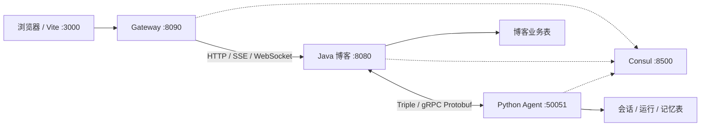

# 服务边界与运行方式

当前是独立进程、统一入口、注册发现与服务数据边界，MySQL 仍使用同一实例和库。线上应进一步按表授予独立数据库账户；迁移与评测脚本可用专门的维护账户。没有配置跨机 TLS、Consul ACL 集群或自动扩缩容。

## 数据与调用

| 所属服务 | 数据 / 能力 | 对方访问方式 |
| --- | --- | --- |
| Java | 用户、公开文章、草稿与版本、文章索引任务、阅读进度 | BlogRpc：有界公开查询、草稿读写、保存回执及维护命令 |
| Python | 会话、消息、运行事件、Checkpoint、画像、记忆、Agent 后台任务 | AgentRpc：聊天、历史、记忆管理、指标查询及管理命令 |

前端传入的用户 ID 不作为服务身份。Java 验证登录态并保留最终业务权限校验，两端 RPC 校验同一个至少 32 字节的 `AGENT_SERVICE_KEY`。查询类型使用固定白名单，无任意 SQL 参数。公开文章查询只返回已发布、未删除且阅读等级为 0 的文章；私有草稿按所有者读取。Java 手写 SQL 统一放 Mapper XML。

## 网关行为

- `/api/**`、`/uploads/**`、`/ws/**` 通过 Consul 的健康博客实例转发。没有开放任意注册服务的自动路由。
- 有登录凭证时先检查 JWT 签名、有效期、HS512 和用户 ID；刷新与退出登录允许过期访问令牌进入 Java 的 Cookie 流程。JWT 不是业务授权的替代。
- 清理客户端伪造的内部身份与转发头，生成 `X-Request-Id`。
- Redis 原子计数按用户（匿名按直连 IP）限流：普通 API 300 次/分钟、认证接口 20 次/分钟、AI 启动/恢复 12 次/分钟。停止、历史和事件订阅使用普通配额。上传文件读取跳过计数；Redis 不可用返回 503。
- 博客 API 与 AI 执行请求分别熔断，停止及历史查询不受 AI 熔断影响，WebSocket 不计入慢请求。熔断窗口 20 次，至少 10 次请求后统计；失败率达到 50% 打开 15 秒，半开允许 3 次探测。未提交的故障响应返回 503，已开始的流不改写正文。HTTP 超时 330 秒，正常长流不会按普通短请求计为慢调用。
- 写操作没有网关或 RPC 自动重试。SSE 按原始帧转发，WebSocket 原样代理。

## 注册发现与部署

本地启动脚本启用 Consul。服务每 10 秒注册并续约，TTL 为 30 秒；Java 与 Python 客户端刷新健康实例间隔 5 秒，注册中心短暂故障允许使用此前实例最多 30 秒，超出后拒绝新调用。健康查询明确返回空列表时立即停止使用旧实例。按用户稳定选取 RPC 实例，连接复用。

| 配置 | 含义 |
| --- | --- |
| `SERVICE_DISCOVERY_ENABLED` | 两端启用 Consul；关闭时仅用于原来的显式直连模式 |
| `CONSUL_URL` / `CONSUL_TOKEN` | 两端 Catalog 地址及 ACL Token |
| `CONSUL_HOST` / `CONSUL_PORT` / `CONSUL_TOKEN` | 网关 Consul 配置 |
| `SERVICE_ADVERTISE_HOST` | 其他服务实际能访问的本机地址；跨机器不能填 127.0.0.1 |
| `BLOG_INSTANCE_ID` / `AGENT_INSTANCE_ID` | 多实例需唯一 |
| `BLOG_RPC_BIND` / `BLOG_RPC_PORT` | Java 内部监听，默认 127.0.0.1:20881 |
| `AGENT_RPC_BIND` | Python 内部监听，默认 127.0.0.1:50051 |
| `AGENT_HTTP_PORT` | Python 注册的 HTTP 端口，应与 uvicorn 一致 |
| `GATEWAY_BIND` / `GATEWAY_PORT` | 网关监听，默认 127.0.0.1:8090 |
| `JWT_SECRET_KEY` | 网关与 Java 相同的至少 64 字节 JWT 密钥 |
| `GATEWAY_API_LIMIT` / `GATEWAY_AUTH_LIMIT` / `GATEWAY_AI_LIMIT` | 每分钟配额 |
| `VITE_API_PROXY` | Vite 后端入口，默认 http://127.0.0.1:8090 |

本地 Consul 使用固定 Docker 镜像与持久化卷，只映射回环端口。跨机器部署需配置受控内网、TLS、Consul ACL 与可靠注册中心。多节点 WebSocket 消息分发仍需独立设计；当前稳定用户 RPC 路由并不提供 WebSocket 跨节点广播。

## 草稿保存的跨服务边界

1. Agent 在会话/运行锁内检查当前执行代次、取消状态及审批哈希，持久化保存意图，签发 120 秒有效的许可，绑定用户、run、文章、正文哈希、草稿版本和乐观锁。
2. Java 校验许可，在一个 20 秒本地事务中预留 `article_agent_save_receipt`、写草稿、完成回执。同 run 的相同保存返回原结果，不重复创建；修改内容或越权调用被拒绝。
3. Agent 写回保存结果。网络超时保留“结果待核对”的意图，不换实例重试写入；维护任务查询 Java 回执，确认成功后回填。无回执且许可过期超过 30 秒才结束未完成保存。
4. 取消发生在意图预留前会阻止保存；预留后返回“正在保存”，不能声称已取消已经开始提交的写操作。签名许可不返回浏览器。

## 验证

- `mvn "-Dtest=!EasyjobApplicationTests" test`：Java 业务、Mapper、签名许可和发现测试。
- `mvn -f gateway/pom.xml test`：身份头、JWT、限流、Redis 故障、熔断及无重试。
- `python scripts/run-agent-offline-tests.py`：禁止网络访问的 Python 回归及边界校验。
- `python scripts/service-split-smoke.py`：本机真实网关、Consul、前端代理、双向 RPC、事件 SSE 与 WebSocket 握手，不调用模型。
- `python scripts/draft-commit-smoke.py`：临时草稿夹具验证许可、取消、幂等保存及回执，自动清理本次夹具。
- GitHub integration 工作流用真实 Agent SQL 查询 peer，禁用模型与后台 worker；Java、网关、Consul 和浏览器真实运行。

回退到原来的直连 Triple 可关闭两端发现、将 Vite 入口显式设回 Java；无需回滚增量表。启用发现的部署必须保持 Triple 传输；HTTP 入口仅供受认证诊断，不能替代跨服务查询与维护。

本地修改网关后可运行 `powershell -NoProfile -ExecutionPolicy Bypass -File scripts/restart-gateway.ps1 -Build`。脚本先在独立输出目录完成构建，成功后只替换并重启核对过的网关进程，构建失败保留正在运行的服务。
